# VELTHARA / WebGuard Security Hub — 기능·변경 이력·보안 코드 리뷰

최신 판단은 [2026-10-28 최종 회원·가상 환경 검증 행렬](validation/2026-10-28-final-review/README.md)과 이 문서 28절 이후를 우선한다. 아래 날짜별 검토는 이력으로 보존한다. 현재 회귀 154개, 1단계 완료·2단계 진행 중이며 운영 간헐 오류의 완전 해결과 모든 플랫폼 실검증을 주장하지 않는다.

작성일: **2026-10-27, 한국 시간** · 검토 소스: **`7565d4f`** · Git 기록 범위: **2026-10-16~2026-10-23, 31개 커밋**

이 보고서는 프로젝트에서 확인한 기능, 요구 변경, 발생 이슈, 보안 문제의 수정 근거와 현재 남은 항목을 한곳에 정리한다. 날짜는 Git 커밋 시각 또는 기존 검증 문서의 기록이며 실제 장애 최초 발생·운영 배포 시각과 동일하다고 가정하지 않는다.

## 1. 현재 결론과 읽는 방법

- **1단계는 공개 웹 기본 진단 MVP 범위에서 완료했고 2단계는 진행 중이다.**
- 현재 등록된 공통 진단 엔진은 **9개**다. 기존 웹 기본 진단은 별도 API로 유지한다.
- 10월 22일 이후 일반 회원도 자신의 진단·저장·재검증·수집 키 관리를 이용한다. DB의 viewer 역할 이름은 남지만 예전의 조회 전용 정책과 다르다.
- 10월 23일 VMware VMX와 GNS3 구성 검사가 추가됐다. Cloud·IoT·Container는 준비 중이며 네트워크 장비 전체 진단이나 하이퍼바이저 취약점 스캔을 제공하는 것은 아니다.
- 오늘 **105개 자동 테스트, production 빌드와 타입 검사, 전체 임시 DB 통합, 보안·6개 언어 HTTP 검증**을 다시 통과했다.
- 정식 사이트 `/signup`에서는 오늘도 **`PROTECTION_UNAVAILABLE`** 오류를 관찰했다. 임시 환경의 검사 성공과 운영 가용성 문제를 구분한다.

보고서의 상태는 **현재 코드 확인 / 이번 실행으로 확인 / 과거 기록 / 미해결 / 미검증**으로 구분한다. 새로 촬영한 사진은 8절에 있으며 운영 사진과 임시 데이터 사진을 명시했다. 실제 운영 계정·DB에 테스트 결과를 추가하지 않았다.

관련 증거: [전체 커밋·소스 목록](REVIEW_HISTORY_2026-10-27.md), [오프라인 리뷰 재현 결과](assets/review-2026-10-27/review-probes.json), [사진·검증 근거 목록](assets/review-2026-10-27/evidence-manifest.json).

## 2. 실제 화면 구조와 전체 진단 엔진

로그인 → `/workbench` 검사 선택 버튼 → **별도 진단 작전실** → 결과·개선안·재검증 순서다. 기존 남색·민트 테마, 로그인 폼과 오른쪽 보안 그림을 유지한다. 긴 안내와 개선안은 토글로 펼친다.

| 검사 ID / 화면 | 추가 근거 | 실제 기능 | 반드시 구분할 한계 |
|---|---|---|---|
| 기존 웹 `/api/scans`, `/?view=web` | 10/16 `fc7cc08`, `0057f11` | 공개 루트 HEAD 1회·TLS·CSP/HSTS/nosniff/Referrer·관찰 쿠키/CORS/정보 노출, 실제 단계 스트림 | GET·로그인 후·모든 경로·전체 TLS 열거·모든 취약점 검사가 아님 |
| `web.compare`, `/workbench/web` | 10/20 `420499a` | PC·모바일 User-Agent별 고정 DNS HEAD 비교 | 실제 모바일 브라우저·PWA·세션·리디렉션은 미검사 |
| `linux.ssh`, Endpoint | 10/20 `420499a` | 명시적 SSH 설정 5개와 근거 줄 번호·개선안 | Include/Match/일부 복잡 구문·기본값·실제 유효 정책·OS 전체·ELF 미검사 |
| `windows.policy`, Endpoint | 10/20 `420499a` | 정책 JSON의 방화벽 3종·Defender·RDP NLA 관찰 | 자기 보고 스냅샷; GPO·예외·타사 백신·실제 OS 종합 진단 아님 |
| `application.pe`, Endpoint | 10/20 `420499a`, `1e1142a` | EXE/DLL PE32/PE32+ ASLR·NX·W+X·서명 구조, 로컬 도구 결과 | 보호 선언은 실제 실행 보호의 증명이 아님. MSI·악성코드·전체 CVE 미지원 |
| `application.apk`, Mobile의 기존 모드 | 10/20 `420499a` | 최대 2 MiB 원본 서버 전송의 APK 구조 예비 검사 | 새 원본 미전송 모드와 다름. 권한·서명·코드 분석 아님 |
| `application.macho`, Endpoint | 10/20 `1e1142a` | Mach-O/Universal·PIE·실행 스택·W+X·서명 명령, 선택형 로컬 도구 | 실제 Mac 서명/공증 신뢰·앱 전체·DMG/PKG·실행 미검증 |
| `application.package`, Mobile | 10/20 `1e1142a`, `86557eb` | APK/AAB/IPA/APKS/XAPK 분류, 제한된 AXML·XML/binary plist의 명시 설정 | AAB protobuf·중첩 APK·실제 권한 승인·서명 신뢰·악성코드 미검사 |
| `virtualization.vmx`, `/workbench/virtualization` | 10/23 `7565d4f` | VMX 복사/붙여넣기/DnD/HGFS·VNC 명시 선언, NIC 연결 모드 | VM 실행·게스트 접속·실효 정책·암호화·VMware CVE·도달성 미검사 |
| `network.gns3`, `/workbench/network` | 10/23 `7565d4f` | GNS3 구조·노드/링크 참조·Cloud/NAT·콘솔 루프백 선언 | 장비 ACL·암호·OS·포트·라우팅·실제 통신은 미검사. GNS3 콘솔 Telnet과 장비 Telnet 서비스를 혼동하지 않음 |

등록 근거: [registry.ts](../lib/assessment/registry.ts), [types.ts](../lib/assessment/types.ts), [설정 검사](../lib/assessment/config-modules.ts), [실행/모바일 요약 검사](../lib/assessment/local-modules.ts), [VMX/GNS3 검사](../lib/assessment/infrastructure-modules.ts).

## 3. 진단 외에 추가된 기능 전수 목록

아래는 고객 기능·자체 방어·운영 도구를 합친 목록이다. 일반 회원에게 노출되는 화면과 로컬 관리 기능을 구분한다.

| 영역 | 등록된 기능·현재 처리 | 주요 코드·문서 |
|---|---|---|
| 가입 | 이메일 정규화, 비밀번호 14~128자, DB 함수의 viewer 강제, 중복 가입 시 기존 해시/역할 유지 | `app/api/register`, `lib/registration.ts`, SQL 가입 함수 |
| 인증 | scrypt+salt, 해시 세션, 8시간 만료, HttpOnly/SameSite·HTTPS Secure 쿠키 | `lib/password.ts`, `app/api/login`, `lib/security.ts` |
| 다른 기기 | 같은 계정의 독립 세션, 로그아웃·만료, 브라우저 세션 변경 시 화면 정리 | 인증 API·`app/home-client.tsx`·Workbench |
| 고객 권한 | 일반 회원의 본인 진단/저장/재검증/AI 요청·집계 키; 관리자 운영 정보는 admin 전용 | `lib/assessment-permission.ts`, [고객 정책](CUSTOMER_ACCESS_2026-10-22.md) |
| 계정 격리 | 목록·개수·이벤트·자산·AI ID/캐시를 계정별 제한. admin도 타 고객 결과 404 | 대시보드·assessments·AI·telemetry API |
| 웹 결과 | 계정+호스트별 안정 ID로 최신 성공 갱신, 실패 시 기존 결과 보존 | `lib/scan-store.ts` |
| 모듈 이력 | 계정+모듈+대상 자산 ID 유지, 매 실행 추가, 버전이 호환될 때만 전후 비교 | `lib/assessment/store.ts`, `compare.ts` |
| 고객 조회 기한 | 최근 30일 결과·자산·AI·수집 키/집계 접근. 목록 개수 제한 유지 | [보관 정책](DATA_RETENTION.md), 각 조회 API |
| 비공개 보관 | 30일 초과 진단을 별도 schema에 트랜잭션 이관, 재실행·잠금·실패 롤백 | migration 009/Prisma 005, `lib/retention.ts` |
| 예약 보관 | Cron 00:00 UTC/한국 09:00 설정, CRON_SECRET만 허용, 횟수·시간 상한 | `vercel.json`, `/api/maintenance/archive` |
| 결과 화면 | 위험도·근거·경고/미검사 개수·접이식 개선안·원문 비포함 JSON | Workbench·assessment panel |
| 작전실 로그 | 실제 서버 단계 스트림·점멸·취소·주소 변경 초기화·로그 JSON | `lib/scan-run.ts`, `app/operations-panel.tsx` |
| 파일 동의 | 선택과 읽기 분리, 현재 파일 일회성 동의, 취소/변경 시 초기화, 저장 동의 별도 | `file-inspection.tsx`, `infrastructure-input.tsx` |
| 대용량 | 최대 8 GiB 입력의 범위 읽기·총 읽기 8 MiB·Worker 시간 제한 | `public/tools/*-inspector.mjs` |
| 구조 제한 | ZIP 수량·경계·중복/위험 경로·압축 비율·출력량, Mach-O 슬라이스 경계 등 | 파일 파서·`tests/file-inspection.test.ts` |
| 로컬 검사 도구 | Node CLI, 명시적 consent, SHA-256·선택 native 서명 조회·기존 출력 덮어쓰기 거절 | `public/tools/executable-inspector.mjs` |
| 요약 신뢰 | 추가 필드·경로·원문 주입 거절, 자기 보고를 서버 독립 안전 판정으로 처리하지 않음 | `executable-snapshot.ts`, `local-modules.ts` |
| 기본 개선안 | 외부 API 없이 제공·추가 호출 없이 토글 | `lib/local-advice.ts` |
| 선택형 AI | Groq→Gemini→기본 안내, OpenAI는 명시 선택, 서버 전용 키 | `lib/ai-providers.ts`, `ai-chain.ts` |
| AI 비용 | 400 출력 토큰·20초·SDK 자동 재시도 0, 24시간 캐시·중복 lease·동시 예산·실패 환불·제공자 대기 | `ai-budget.ts`, `advice-cache.ts`, AI API |
| 다국어 | 기존 웹/가입/오류 6개 언어, 신규 작전실 한국어·영어, 명시 선택 우선·신뢰 국가 힌트 | locale/messages·request-locale·geo-country |
| 외부 집계 | 자산별 256-bit 키 발급/회전·해시 보관, 서버 간 집계 수신, 최근 5분 임계 신호 | `/api/telemetry`, `trafficSignals` |
| 자체 IP 방어 | 실제 접속 IP·위험 URL 패턴, 5분 차단 5회 뒤 6번째 블랙리스트, 차단 중 strike 비증가 | `lib/ingress-guard.ts`, Vercel Proxy |
| 프록시 신뢰 | 일반 위조 forwarded header 무시, 로컬 프록시 secret·Vercel 플랫폼 IP 경계 | ingress/tunnel/vercel-protection |
| 최소 디코이 | 정해진 경로의 제한된 이벤트·404. 완전한 격리형 허니팟 아님 | catch-all probe·decoy route |
| 요청 방어 | Origin+Host, JSON MIME·실제 바이트 제한, SQL 파라미터, 고정 모듈 레지스트리 | `lib/request.ts`, security·assessment input |
| 보안 헤더 | CSP·프레임 거절·nosniff·Referrer·권한 정책, 서버 식별 축소 | `next.config.ts` |
| 운영 연결 | 로컬/Prisma 제공자 프로필·검증 TLS·프로젝트 ID·readiness·제공자별 풀 | project-database/database-pool/readiness |
| SQL 관리 | 일반 PG 001~010, Prisma 001~006, 체크섬·트랜잭션·반복 검증·개발 역할 분리 | `sql/`, migrate·grant 스크립트 |
| 운영 복구 | 로컬 관리용 비밀번호 재설정·세션 폐기·감사·부분 실패 롤백, IP 해제 | `scripts/reset-password.ts`, `unblock-ip.ts` |
| 데이터 이전 | 빈 대상만 허용, 기존 사용자/결과 보존, 세션·수집 키 복사 제외 | copy-production-data 스크립트 |
| 환경정보 보호 | 환경 파일 전체 Git 제외, 추적 중이던 템플릿 제거 | 10/23 `5d53617`, `.gitignore` |

Cloud·IoT·Container, 작업 예약 진단, 정식 PDF 보고서, 메일 인증/MFA/공개 비밀번호 찾기, 외부 WAF/봇 확정 판별·IP 역추적·자동 대응·고객 장비 자동 접속은 현재 완료 기능으로 세지 않는다. 로컬 관리용 비밀번호 복구와 고객용 비밀번호 찾기는 별개다.

## 4. 언제·왜·어떻게 바뀌었는가

| 날짜·커밋 | 요구·문제 | 변경 방식 |
|---|---|---|
| 10/16 `fc7cc08`, `0057f11` | URL 진단과 진행 상태·AI 한도·자체 방어 필요 | 작전실·기본 검사·개선안·API 전환·한도·IP 보호를 MVP에 묶음 |
| 10/16 `b75dc48`~`c1d4a8c` | 다른 기기 접속·HTTP/HTTPS·PC 임시 공유와 Vercel 혼동 | HTTP→HTTPS 및 정확한 Origin/Host, 임시 PC 공유와 Vercel 직접 운영 구성 분리 |
| 10/16 `d78f1be`, `26055be` | Vercel의 localhost DB·Prisma 역할/GRANT 실패 | 외부 Prisma DB 프로필·TLS·별도 SQL 경로·제공자 권한 제한 공개 |
| 10/16 `8390374` | 로그인 헤더/가입 노출·빈 오른쪽 영역 | 기존 로그인 전용 폼과 보안 SVG 구성 |
| 10/17 `5c5455f` | 헤더 존재만으로 통과·취소/입력/풀 호환성 문제 | 정책값·인증서·쿠키/CORS 분석, 취소·입력·역할 검증·회귀 검사 보완 |
| 10/17 `d389dd8` | 가입·로그인 서비스 필요 | 운영 공개 가입, 당시 viewer 조회 정책 |
| 10/17 `c4d07dc`, `5690023` | 다른 계정 주소/진단 공유·AI ID 접근 위험 | 소유자 조건·계정별 유일키·이벤트/AI 캐시 격리·실환경 교차 검사 |
| 10/17 `5816713` | 비밀번호 조회/복구 혼동 | 비밀번호 원문 조회 대신 관리용 숨김 입력 재설정·세션 폐기·롤백 |
| 10/19 `f7af285`, `fa259fa` | 다른 기기에서 접속 보호 503 | 일시적 차단 조회 읽기만 1회 재시도·실패 연결 폐기, 보호 우회 금지 |
| 10/20 `420499a`~`c1c1cb8` | 2단계 시스템/앱·비교·집계 확장 | 공통 모듈·불변 이력·자산·재검증·서버 집계·운영 검증 |
| 10/20 `1e1142a`, `86557eb` | 무거운 EXE/Mac/모바일 파일·동의 요구 | 브라우저 부분 읽기·요약·확장 형식·binary plist·로컬 도구 |
| 10/21 `08a6307`, `fb7a54c` | 통합 플랫폼 선택 화면 요구 | 최초 밝은 카드·홈 펼침 폼 구현·검증. 이후 사용자 의도와 달라 대체 |
| 10/21 `7236fc4` | 버튼→별도 검사 페이지, 기존 웹/테마/로그인 유지 요청 | 현재 전용 작전실 라우팅과 남색·민트 테마·기존 로그인 복원 |
| 10/22 `83096b2` | 단계·다른 컴퓨터 Linux/네트워크 검증 정리 | prompt와 실환경 검증 계획 갱신 |
| 10/22 `36af967` | 설정 바꿔도 동의 유지·파일 없음·오류 안내/경고 부재 | 동의 초기화·비동기 세대/취소·입력 잠금·파일 오류·경고 요약·보호 전용 복구 |
| 10/22 `1f977d5` | 보호 DB 조회가 기존 5초를 넘겨 실패 | 정확한 관리형 차단 SELECT만 10초·단계별 비밀 없는 로그·실제 지연 DB 검증 |
| 10/22 `5832563` | 일반 고객이 진단을 못 하는 정책 불일치 | viewer 역할을 승격하지 않고 본인 진단 권한을 허용; 관리자 운영 권한 분리 유지 |
| 10/23 `128772e` | 고객 결과의 조회 기한·오래된 기록 보존 | API 30일 필터·비공개 archive·인증된 정기 작업·원자적 이관 |
| 10/23 `5d53617` | 환경 설정 파일을 원격에 포함하지 않는 요구 | 템플릿 추적 제거·환경 파일 이름 전반 ignore. 실제 키 유출 확인과는 다름 |
| 10/23 `7565d4f` | VM·네트워크 설정 검사 요구 | VMX/GNS3 전용 화면·파서·근거·제한·고객 격리·검증 |

빠짐없는 31개 커밋 원문과 한국 시간은 [전체 변경 이력](REVIEW_HISTORY_2026-10-27.md)에 별도 수록했다. 한 커밋에 여러 사전 작업이 묶인 경우 더 세밀한 발생 시점을 추측하지 않았다.

## 5. 취약점·보안 위험과 실제 수정 근거

발생했던 기능 오류를 모두 취약점으로 부르지 않는다. 아래는 코드에서 확인한 위험과 방어이며 실제 침해·키 탈취가 발생했다는 뜻은 아니다.

### 5.1 계정 간 결과 노출·AI 결과 ID 접근 — 수정 확인

**영향:** 로그인한 사용자가 다른 계정의 도메인·진단·활동을 보거나 타 계정 진단 ID로 AI 처리를 요청할 수 있었던 소유권 검사 부족. 심각도는 높음으로 평가한다.

`c4d07dc`의 실제 diff에서 다음 변경을 확인했다.

```sql
-- 이전: 전체 목록 / ID만으로 결과 선택
SELECT ... FROM scans ORDER BY created_at DESC LIMIT 30;
SELECT result FROM scans WHERE id=$1;

-- 수정: 세션 사용자 소유권 조건
SELECT ... FROM scans WHERE user_id=$1 ORDER BY created_at DESC LIMIT 30;
SELECT result FROM scans WHERE id=$1 AND user_id=$2;
```

호스트 유일성도 `hostname`에서 `(user_id,hostname)`으로 바꾸고 upsert가 소유자를 덮어쓰지 않도록 했다. AI 캐시 키·이벤트에도 계정을 포함했다. 현재 코드는 여기에 30일 필터까지 적용한다. **이번 통합 검증에서 관리자 포함 타 계정 404·같은 호스트 독립 결과·계정별 이벤트/캐시를 확인했다.**

근거: [dashboard API](../app/api/dashboard/route.ts), [AI API](../app/api/ai/route.ts), [scan-store](../lib/scan-store.ts), [006 migration](../sql/migrations/006_account_isolation.sql).

### 5.2 SSRF·프록시 IP 위조 — 방어 구현·현재 회귀 통과

HTTPS/443 루트·일반 도메인만 허용하고 DNS의 모든 응답을 검사한다. 하나라도 비공개/특수 주소면 연결 전 거절한다. 검증 IP를 HTTPS lookup에 고정하고 TLS 인증서를 검증하며 리디렉션을 따라가지 않는다. 일반 클라이언트의 위조 전달 헤더는 무시한다.

이번 테스트는 URL 우회·혼합 DNS·메타데이터 주소·DNS 고정·TLS 실패·취소와 위조 헤더를 포함한다. 이는 방어 검증이며 **실제 SSRF 침해가 과거 발생했다는 증거는 없다.**

근거: [scan-policy](../lib/scan-policy.ts), [scanner](../lib/scanner.ts), [ingress-guard](../lib/ingress-guard.ts), [관련 테스트](../tests/security.test.ts).

### 5.3 파일 읽기 동의·입력 변경 경합 — 수정 확인

설정을 바꾸거나 파일을 바꾼 후 이전 동의가 유지되면 다른 내용에 대한 승인을 재사용할 위험이 있다. `36af967`에서 설정 변경 시 동의 해제·비동기 읽기 세대 비교·전송 중 잠금·Enter와 버튼의 제출 조건 통일을 적용했다. 파일 미선택/빈 파일/손상 파일을 구분하고 자동 샘플을 실제 파일처럼 읽지 않는다.

근거: [Workbench](../app/workbench/workbench-client.tsx), [파일 읽기](../app/workbench/file-inspection.tsx), [인프라 설정 읽기](../app/workbench/infrastructure-input.tsx). 이번 브라우저는 파일 미선택 오류와 저장 비활성, Linux 재검증 후 경고→개선 비교를 확인했다.

### 5.4 대용량·악성 구조·요약 위조 — 입력 경계 확인

파일 크기·총 읽기·목록 수·슬라이스·압축 출력·시간 제한을 적용한다. ZIP 위험 경로·중복·손상, Mach-O 겹친 범위 등을 거절하고 파일을 실행하지 않는다. 서버 요약 검증은 허용 필드·형식·범위를 제한하며 임의 경로·원문 속성을 거절한다. 사용자 제공 서명 결과나 헤더 선언은 서버 독립 안전 판정으로 승격하지 않는다.

근거: [실행 파일 파서](../public/tools/executable-inspector.mjs), [모바일 파서](../public/tools/package-inspector.mjs), [서버 요약 검증](../lib/assessment/executable-snapshot.ts), [파일 회귀 테스트](../tests/file-inspection.test.ts). 모든 파일의 안전을 보장하는 샌드박스/백신 엔진은 아니다.

### 5.5 AI 비용·실패 한도·중복 생성 — 보완 확인

기존 기록에는 키/모델 접근·잔액/요청 한도 오류와 실패 시도 누적이 있었다. 현재는 시도 제한과 성공 예산을 분리해 요청 전에 원자 예약하고 실패한 원래 시간창에만 환불한다. 계정·언어·모델·규칙 입력 기반 캐시, lease, 제공자별 대기, SDK 자동 재시도 제거를 적용한다. raw HTTP 응답 대신 정해진 헤더 존재 Boolean만 AI 입력으로 만든다.

이번 외부 AI 생성은 실행하지 않았다. 로컬 모형 통합에서 비용 예약·환불·동시 제한·캐시·제공자 실패 처리를 확인했다. 실제 제공자의 잔액/모델 지원을 보증하지 않는다.

근거: [ai-budget](../lib/ai-budget.ts), [advice-cache](../lib/advice-cache.ts), [ai-providers](../lib/ai-providers.ts), [누적 기록](../VALIDATION.md).

### 5.6 오래된 진단의 고객 노출·보관 실패 — 정책·원자성 보완

`128772e`에서 고객 API에 30일 필터를 적용하고 소유자가 같은 오래된 ID도 직접 조회되지 않게 했다. 보관 INSERT와 활성 행 이관을 같은 트랜잭션에서 처리하며 고정 함수·잠금·중복 방지·관리 인증을 둔다. 보관 실패 시 원본 유지·재실행·계정 격리를 이번 통합에서 통과했다. 기존 데이터 유실 사고가 확인됐다는 의미는 아니다.

근거: [보관 SQL](../sql/migrations/009_diagnostic_retention.sql), [Cron API](../app/api/maintenance/archive/route.ts), [retention](../lib/retention.ts), [보관 정책](DATA_RETENTION.md).

## 6. 일반 이슈와 해결 과정

| 이슈 | 원인·성격 | 조치·현재 판단 |
|---|---|---|
| Vercel 로그인 실패 | localhost DB·APP_ORIGIN 불일치, 배포 구성 오류 | 외부 DB·정식 Origin·TLS·직접/풀 프로필. 오늘 운영 전체 로그인을 재검증한 것은 아님 |
| DB role/GRANT 거절 | 관리형 제공자 기능 제한 | Prisma 전용 migration·권한 모델 공개. 실제 DB ACL 분리 한계는 남음 |
| 풀 시작 옵션·정상 DML 거절 | statement_timeout 호환성 및 보조 SQL 검사 과잉 | 제공자별 풀, 정상 UPDATE/upsert 허용·DDL 거절 회귀 |
| 다른 기기의 접속 보호 503 | 차단 조회 지연·연결 장애. 기기 계정 고정 문제와 별개 | 읽기만 재시도·정확한 SELECT만 10초. **오늘 운영 signup에서 같은 종류 오류 관찰; 근본 해결 완료로 쓰지 않음** |
| 일반 회원 진단 버튼 비활성 | 관리자만 실행하게 만든 과거 정책과 고객 서비스 목적 불일치 | 10/22 본인 진단 허용. 관리자 정보·타 계정 접근은 계속 제한 |
| 밝은 홈·펼침 폼이 의도와 다름 | UI 요구 해석 오류 | 10/21 버튼→전용 페이지·기존 웹·어두운 테마·로그인 복원 |
| 주소/계정 변경 후 오래된 응답 | 비동기 화면 상태 경합 | 요청 세대 비교·취소·상태 초기화·계정 변경 방송 |
| DNS 취소 지연 | 대기 작업 종료 처리 부족 | AbortSignal·DNS 타이머/리스너 정리·연결 전 중단 |
| 파일 없음·빈 파일·혼동되는 오류 | 검증/피드백 부족 | 명시적 오류·동의 초기화·검사별 오류 코드·경고/미검사 요약 |
| 한글 경로 initdb·빌드 권한 | Windows 검증 환경 제약 | 임시 PG를 ASCII/OS temp 경로로 분리·허용된 실행으로 동일 검사 재수행 |
| `.env`의 #·URL 비밀번호 혼동 | 환경 문법과 DB 계정 비밀번호 변경의 차이 | URL 비밀번호 부분의 percent encoding과 DB 역할 비밀번호를 구분해 안내. 웹 로그인 비밀번호에 URL 인코딩을 적용하지 않음 |
| 환경 템플릿 추적 | 환경 파일 원격 제외 요구 | 10/23 추적 제거·이름 패턴 ignore. 과거 키 유출 여부나 Git 전체 비밀 이력 감사는 미확인 |

## 7. 현재 코드 리뷰: 미해결·추가 검토 항목

P1은 우선 대응할 운영/보안 위험, P2는 후속 보완 항목이다. 아래 항목을 모두 실제 악용 취약점으로 확정하지 않는다. 이번 요청에서는 제품 코드를 수정하거나 운영 설정을 바꾸지 않았다.

| ID·우선순위 | 근거·관찰 | 영향·판단 | 후속 조치 |
|---|---|---|---|
| R01 · P1 운영 가용성 | 오늘 정식 `/signup` 화면에 PROTECTION_UNAVAILABLE 표시. [사진 11](assets/review-2026-10-27/11-production-protection-error.jpg) | 일반 사용자의 접속/가입도 차단될 수 있음. 특정 제공자 원인·상시 재현률은 미확인 | 같은 시각의 Proxy 로그·풀 대기/조회 시간·DB 제공자 상태 대조. 보호 우회로 해결하지 않음 |
| R02 · P1 보안 경계 | [runtime-sql.ts L1~6](../lib/runtime-sql.ts), 관리형 제공자 역할 제약 | 정규식 SQL 검사는 탈취된 광범위 DB 키의 권한을 줄이지 못함. 실제 키 탈취는 확인되지 않음 | 최소 권한을 제공하는 DB 모델·네트워크/비밀 관리·복구 전략 검토 |
| R03 · P2 CSP 완화 | [next.config.ts L13](../next.config.ts)에 script/style unsafe-inline | XSS 발생 시 추가 방어력이 약함. 이 리뷰에서 실행 가능한 XSS를 확인한 것은 아님 | nonce/hash 기반 정책과 MUI/Next 호환성 별도 검증 |
| R04 · P2 공유 한도 | [login route L8](../app/api/login/route.ts)의 전체 30회/분, 가입 전체 10회/10분 | 한 사용자의 요청이 다른 정상 사용자의 예산을 소진할 가능성. 운영 부하 실험은 하지 않음 | 신뢰 IP·계정·서비스 전체 한도의 계층화와 악용/정상 부하 검증 |
| R05 · P2 버전 검증 | [infrastructure-modules.ts L34](../lib/assessment/infrastructure-modules.ts)는 version 문자열 여부만 검사. `999.0`도 오프라인 실행에서 허용됨 | GNS3 2.x라는 표시와 입력 허용 범위가 불일치. 호환성/오판 위험이며 코드 실행 취약점은 입증되지 않음 | 지원 버전 경계 검사·미지원 버전 거절/미검사 정책·회귀 사례 추가 |
| R06 · P2 문서 불일치 | prompt.md·PHASE2.md에 viewer 조회 전용·Network/Virtualization 준비 중 설명이 남음 | 10/22~23 이후 코드와 상충. 현재 권한·지원 범위 판단을 잘못할 수 있음 | 최신 정책·지원표로 정리하고 과거 이력은 날짜별 보존. 이 보고서는 현재 코드를 기준으로 함 |
| R07 · P2 배포 준비 검사 | [deployment-readiness.ts](../lib/deployment-readiness.ts)는 표/보관 함수는 확인하지만 새 모듈 허용 제약까지 확인하지 않음 | 이전 schema와 새 앱 조합에서 READY여도 새 ID 저장이 실패할 가능성. 실제 운영 실패 재현은 하지 않음 | 적용 migration 버전·모듈 허용 schema 호환 검사 추가 검토 |

R05 재현은 [review-probes.json](assets/review-2026-10-27/review-probes.json)에 남겼다. 가짜 버전의 빈 토폴로지를 메모리에서 분석했으며 운영 서버·장비에 보내지 않았다.

추가 한계: 메일 인증·MFA·고객 복구 UI, 장기 archive 자동 삭제 기한·복구 UI, 실물 Mac/iOS·모든 Linux 유효 정책, 장비/클라우드 종합 진단, 새로운 의존성 CVE 감사·침투/부하 시험은 이번 검증으로 완료되지 않는다.

## 8. 실제 촬영 스크린샷

촬영일은 모두 **2026-10-27**이다. 원본 JPG를 프로젝트에 포함했으며 이미지 편집·결과 합성·과거 화면의 현재 화면 위장은 하지 않았다. 사진 01·11만 정식 운영 사이트이며 나머지는 `7565d4f`의 별도 빌드와 임시 PostgreSQL·일반 회원 `review-demo@example.test`를 사용했다. 이 이메일은 데모용이며 비밀번호·쿠키·운영 개인정보는 사진에 넣지 않았다.

### 01. 정식 사이트 로그인 — 운영 화면

기존 남색 테마·폼·언어 선택·오른쪽 보안 그림을 확인했다. 로그인 성공·DB 전체 정상의 증거로 대신하지 않는다.

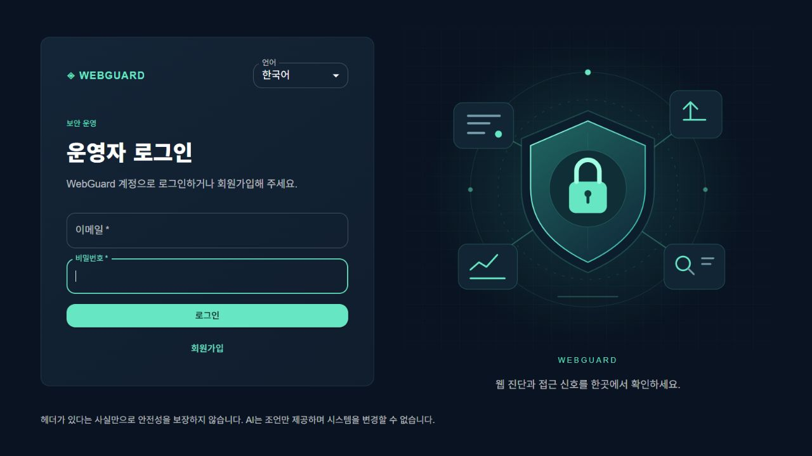

### 02. 검사 선택 버튼 — 임시 환경

Web/Mobile/Endpoint/Virtualization/Network는 검사 화면으로 이동하며 Cloud/IoT/Container는 준비 중이다.

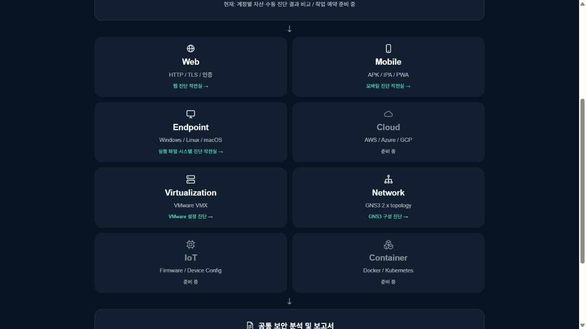

### 03. 파일 미선택·읽기 동의 보호 — 임시 환경

파일 없는 점검에 명시적 오류가 표시되고 요약 저장은 비활성이다. 이번 사진은 실제 모바일 앱 파일 분석의 증거가 아니다.

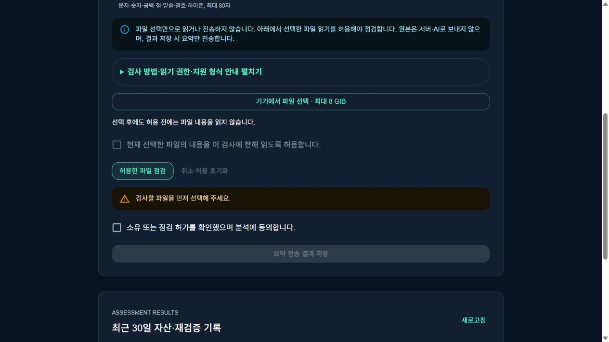

### 04. 실행 파일·시스템 진단 작전실 — 임시 환경

PE·Mac 실행 파일과 Linux/Windows 설정 검사 선택을 제공한다. 원본 미전송과 동의 안내를 확인했다.

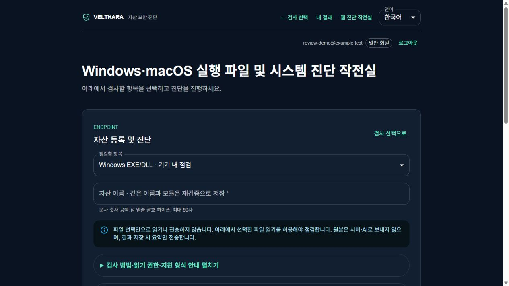

### 05~06. Linux 경고 5개 → 개선 관찰 5개 — 합성 설정

일반 회원의 실제 UI 제출·임시 DB 저장·재검증을 촬영했다. 실제 Linux 서버의 설정을 변경한 결과가 아니다.


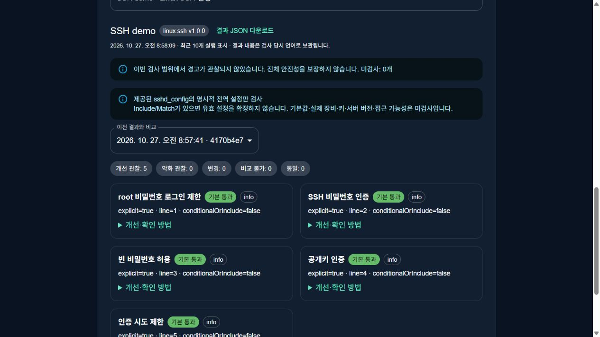

### 07. VMware VMX — 합성 설정

복사 격리 미선언 보호와 VNC 활성 선언에 경고 2개, 나머지 확인 불가 4개를 표시했다. VM 실행이나 실제 게스트 정책 검증은 하지 않았다.

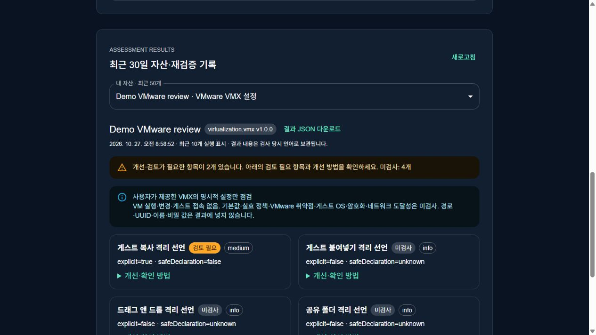

### 08. GNS3 네트워크 구성 — 합성 설정

Cloud 연결과 비루프백 콘솔 선언에 경고 2개, 실제 장비 정책은 미검사 1개다. 실제 포트 스캔·노드 실행·ping 검증을 수행한 사진이 아니다.

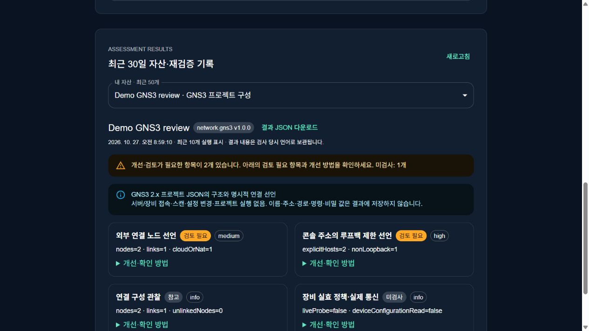

### 09. 내 진단 결과·최근 30일 안내 — 임시 환경

선택 자산과 JSON 다운로드·현재 경고를 표시한다. 30일 경과 동작 자체는 사진이 아닌 날짜를 조절한 독립 DB 통합 테스트로 검증했다.

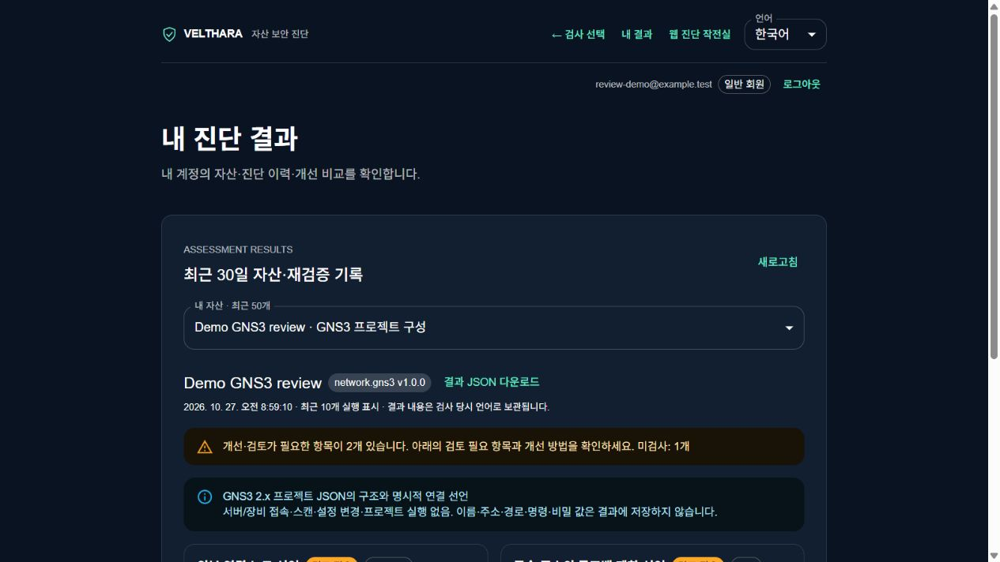

### 10. 기존 웹 진단 작전실 — 임시 환경

URL·진단 허가·범위 안내·본인 이벤트·AI 비활성 안내를 확인했다. 이번 촬영에서 외부 사이트 진단 요청은 보내지 않았다.

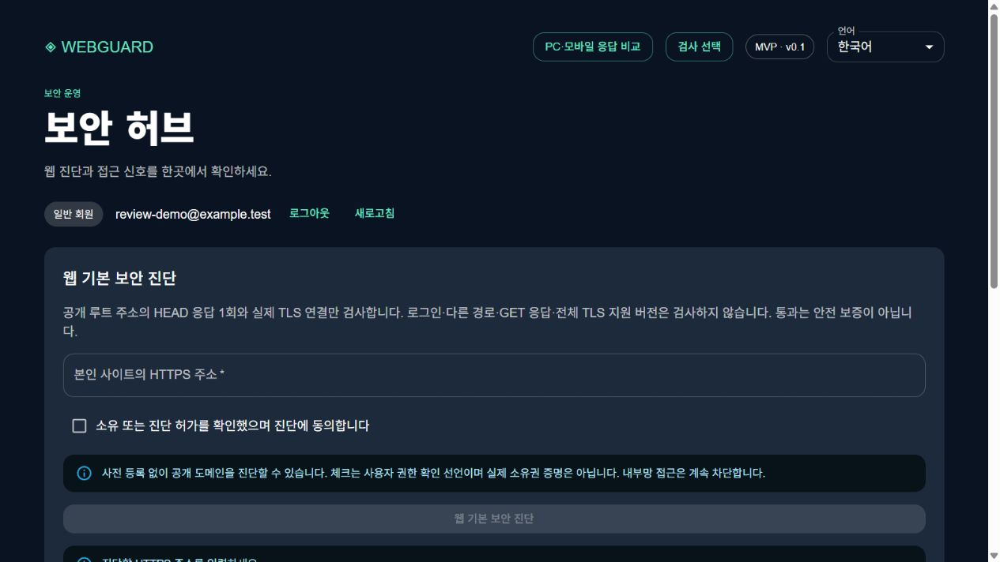

### 11. 오늘 관찰한 정식 사이트 오류 — 운영 화면

`/signup` 이동 뒤 접속 보호 상태 확인 실패 JSON을 관찰했다. 과거의 보호 지연 보완을 근본 해결 완료라고 쓰지 않기 위한 현재 증거다. 단일 관찰이며 원인·전체 장애 범위는 미확정이다.

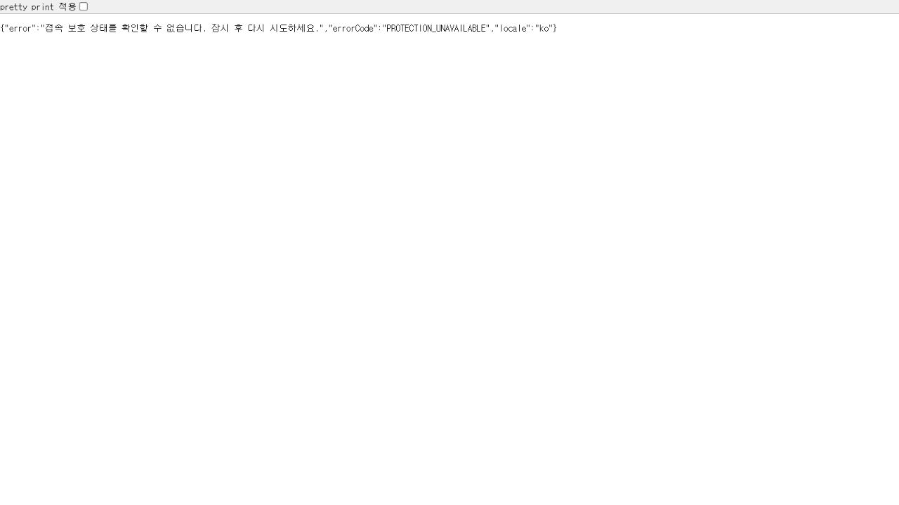

### 12. 회원가입 폼·현재 고객 권한 안내 — 임시 환경

가입 후 본인 진단 이용 안내와 비밀번호 정책을 확인했다. 폼 제출로 운영 계정을 만들지 않았다.

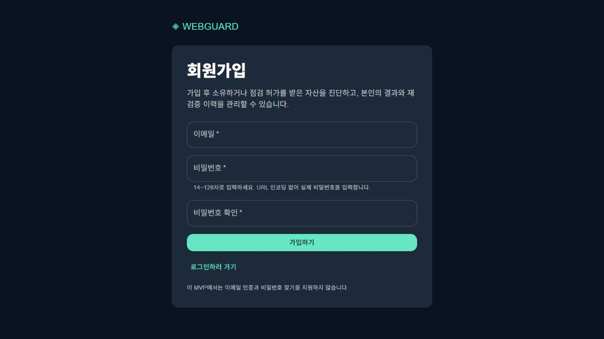

## 9. 이번 실행 검증과 과거 기록의 구분

| 항목 | 이번 결과 | 범위 |
|---|---|---|
| 단위·보안·회귀 | 105개 통과, 실패 0 | SSRF·권한·IP·파일·모듈·보관 인증·동의/취소·AI 등 |
| production 빌드 | 통과 | `.next-verify`, TypeScript 검사 포함. 운영 배포를 변경하지 않음 |
| 전체 API/DB 통합 | 통과 | 임시 PG: 일반 010/Prisma 006, 일반 고객 진단·격리·이력·집계·보관·롤백·복구 |
| 지연 보호 조회 | 통과 | 임시 DB 6초 지연에서 기존 5초 실패·범위 한정 10초 성공 |
| 보안 HTTP smoke | 통과 | 보안 헤더·미인증·교차 Origin 거절 |
| 6개 언어 smoke | 통과 | SSR·API 오류·설정 지속·위조 국가 힌트 거절 |
| 브라우저 | 확인 | 일반 회원 로그인, 파일 없음 오류, Linux 경고/개선, VMX/GNS3 저장, 이력·웹/가입 화면 |
| GNS3 미지원 버전 | 허용됨을 재현 | R05로 기록; 수정 완료 아님 |
| 정식 사이트 | 공개 로그인 확인·가입 경로 오류 관찰 | 운영 전체 회귀·로그 분석·DB 점검을 대신하지 않음 |

과거 문서의 실제 VMware VMX·GNS3 VPCS ping 검증은 [10/23 기록](INFRASTRUCTURE_CHECKS.md)에 있다. 이번에는 장비를 켜거나 접속하지 않았다. Kali 접속/유효 정책·Mac 서명·실물 앱 설치·실행의 미완료 상태를 과거 합성 검사로 덮지 않는다.

## 10. 다음 작업 우선순위

1. R01 운영 보호 오류의 요청 시각과 서버·제공자 지표 대조, 정상 사용자 접근 복구 확인.
2. R02 관리형 DB 최소 권한·비밀 유출/복구 경계 검토.
3. R05 GNS3 지원 버전 검증과 R07 앱/schema 호환 readiness 보완.
4. R03 CSP 강화·R04 로그인/가입 한도의 정상 사용자 영향 검토.
5. R06 prompt·PHASE2·PROJECT_STATUS를 최신 권한·VMX/GNS3 범위로 정리.
6. 다른 컴퓨터 Linux 유효 설정, 실제 Mac·모바일·장비 검증을 대상별로 기록하고 2단계 완료 조건을 판단.

이번 산출물은 보고서·스크린샷·검증 근거이며 제품 기능 코드·운영 계정·환경변수·배포·migration을 변경하지 않았다. 기능 검토와 회귀 통과는 무취약점 인증이나 모든 장비의 안전 보증이 아니다.


## 11. 후속 검증 — R01~R07·취약/보완 더미 파일 (2026-10-27)

앞의 1~10절은 HEAD 7565d4f 시점의 최초 검토 기록이다. 이 절은 **그 이후 로컬 작업본의 실제 코드 수정과 재검증**이다. 이전 R05 미지원 버전 허용 관찰은 과거 재현 기록으로 보존하며 아래 결과로 수정 상태를 구분한다. 이번 수정은 아직 Git 업로드·운영 배포하지 않았다. 운영 응답 재조회는 기존 배포를 관찰한 것이며 로컬 수정의 운영 적용 증거가 아니다.

### 11.1 항목별 조치와 잔여 위험

| 항목 | 이번 작업·증거 | 판단 |
|---|---|---|
| R01 | Vercel 요청 로그 17개 조회. 2026-10-26 23:59:34.230 UTC(한국 10/27 08:59:34) signup 503, 10/27 00:32:07.700 UTC(09:32:07) signup 200. 두 요청 WAF allow. health/ready/root도 200 재관찰 | 복구 응답 관찰. Hobby runtime 로그가 요청한 2시간 범위를 보존하지 않아 HTTP 400으로 조회 불가. DB 제공자 지표·오류 당시 runtime 원인·다른 실제 기기 로그인/진단의 영구 복구는 미확정 |
| R02 | 자체 PG 역할 분리·관리형 앱 SQL 차단/소유자 조건·비밀 노출/복구 경계 검토. 별도 DB 복구 절차 작성 | 제공자 실제 최소 권한·백업 복구·유출 키 폐기 실증은 남음. 앱 차단 검사는 탈취 자격의 직접 DB 접속을 제한하지 못함 |
| R03 | Proxy가 요청마다 새 nonce를 발급하고 request CSP/x-nonce와 response CSP를 설정. Next/MUI에 전달. script unsafe-inline 제거, production unsafe-eval 없음 | HTML의 모든 script nonce 일치·요청별 교체 smoke 통과. 실제 로그인·라우팅·파일 Worker 정상, 브라우저 warn/error 0 관찰. style unsafe-inline은 호환성 경계로 유지 |
| R04 | 로그인: 출처30/분→전체300/분→계정5/5분. 가입: 출처10/10분→전체100/10분→계정3/시간. Vercel 공식 IP 또는 로컬 gateway HMAC 서명 peer만 사용 | 서로 다른 신뢰 peer의 bucket 분리/위조 거절 단위 검증, 임시 API의 계정 한도/다른 정상 계정 로그인 통과. 공유 NAT는 출처 예산을 공유하며 글로벌 회로 예산도 남음. 운영 부하 실험은 하지 않음 |
| R05 | GNS3 version이 2.x 형식이어야 입력 허용. 모듈 v1.0.1로 변경. 2.2.61 합성 입력 저장 및 3.0.0 UI/API 거절 | 입력 버전 게이트 수정·회귀 통과. 실제 GNS3 앱의 모든 2.x 릴리스 호환 인증은 아님. 미지원 입력 실패 시 이전 성공 기록 유지 |
| R06 | prompt/PHASE2/PROJECT_STATUS의 일반 회원 권한·VMX/GNS3 범위 모순 수정 | 현재 문서 정합성 보완. 과거 기록은 당시 상태로 구분 |
| R07 | readiness에서 검증된 assessment_assets_module_id_check와 레지스트리 9종 ID의 호환 확인. 누락/이전/미검증 제약 거절 | 새 DATABASE_MODULE_SCHEMA_NOT_READY와 정상 통합 검증 통과. 적용된 migration 내용은 변경하지 않음 |

근거: [운영 재관찰](assets/phase2-fixtures-2026-10-27/r01-observation.json), [비밀/개인정보를 제외한 요청 기록](assets/phase2-fixtures-2026-10-27/r01-request-correlation.json), [관리형 DB·유출 복구 경계](DB_SECRET_RECOVERY.md). WAF allow는 앱 내부 보호 성공을 뜻하지 않으며, 200 한 번으로 간헐적 DB 장애가 해결됐다고 하지 않는다.

### 11.2 더미 파일과 검사 결과

[더미 파일 사용법](../tests/fixtures/phase2/README.md). 총 16개 파일은 합성 입력이며 실행·설치·실제 OS 설정 적용·VM/GNS3 실행용이 아니다. PE/Mach-O/APK/IPA는 최소 구조 입력으로 정상 실행/설치 가능한 앱이 아니다. 악성코드 샘플을 사용하지 않았다. 원본 운영 DB와 분리한 임시 PostgreSQL·loopback 서버에서 AI 호출 없이 일반 회원으로 확인했다.

설정 4종은 저장한 파일 내용을 직접 입력했고 PE/Mach-O/APK/IPA 4종은 실제 파일 선택→읽기 동의→Worker 검사→소유 동의→요약 저장으로 확인했다. 파일 읽기/취소 동의의 기존 자동 회귀도 유지했다. 설정 파일 선택 UI 자체의 전후 실장비 검증까지 대신하는 것은 아니다.

| 대상 | 취약 선언 경고 | 보완 선언 경고 | 보완 후 기본 통과 / 참고 / 미검사 |
|---|---:|---:|---|
| linux | 5 | 0 | 5 / 0 / 0 |
| windows | 6 | 0 | 6 / 0 / 0 |
| vmware | 6 | 0 | 5 / 1 / 0 |
| gns3 | 2 | 0 | 1 / 2 / 1 |
| windows-pe | 3 | 0 | 0 / 5 / 1 |
| macos-macho | 3 | 0 | 0 / 5 / 4 |
| android | 3 | 0 | 0 / 5 / 3 |
| ios | 1 | 0 | 0 / 2 / 3 |

전후 비교에서 warning→pass만 '개선 관찰'로 계산한다. 파일 선언의 warning→info는 '변경'이며 안전 인증으로 승격하지 않는다. VMX는 개선5·변경1, GNS3는 개선1·변경1·비교불가1이다. IPA는 ATS 선언 외에 패키지 크기도 달라져 변경2가 표시되며 보안 개선 두 개를 뜻하지 않는다. 미검사가 같은 상태로 남아도 비교불가로 표시한다.

[실제 파일 파서·검사 결과와 SHA-256](assets/phase2-fixtures-2026-10-27/fixture-results.json), [일부 화면의 구조화 관찰](assets/phase2-fixtures-2026-10-27/browser-results.json), [다운로드한 저장 결과](assets/phase2-fixtures-2026-10-27/gns3-browser-download.json), [독립 결과와의 교차 대조](assets/phase2-fixtures-2026-10-27/cross-check.json), [파일/사진 무결성 목록](assets/phase2-fixtures-2026-10-27/manifest.json).

### 11.3 전후 스크린샷

총 18장 추가. 아래 사진은 모두 임시 로컬 검증 서버의 실제 화면이며 운영 배포 화면이 아니다. 임시 계정·합성 입력만 사용했다. 주소/기기 OS·실제 장비 검증을 증명하는 사진과 혼동하지 않는다.

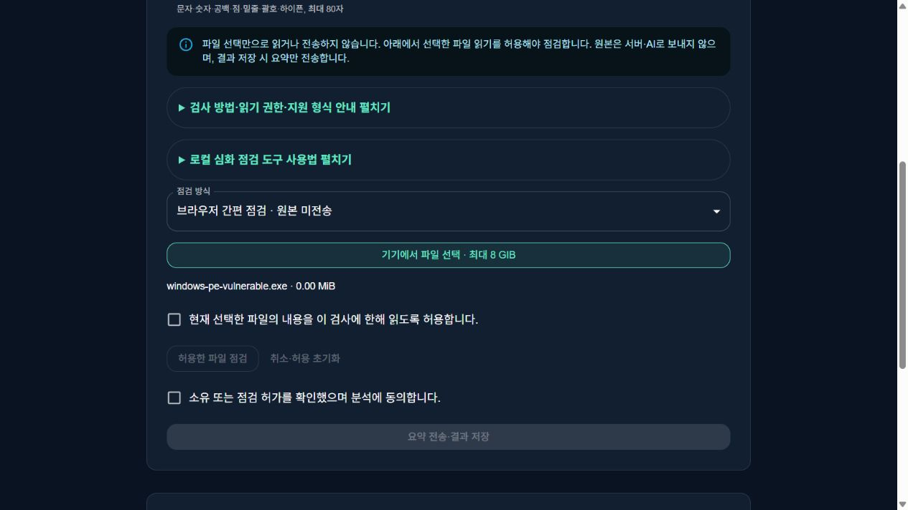

#### windows-pe — 취약 선언 / 보완 선언

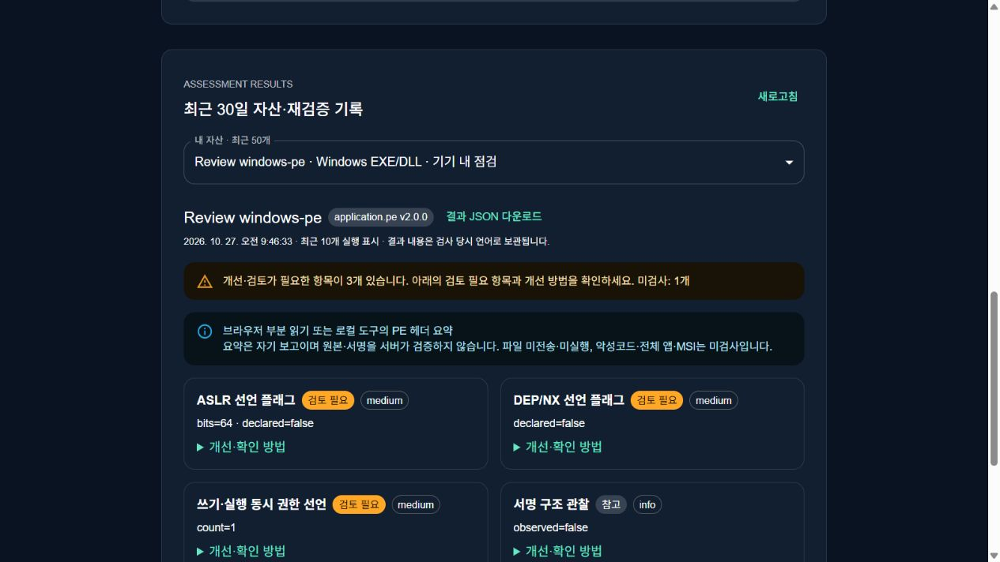

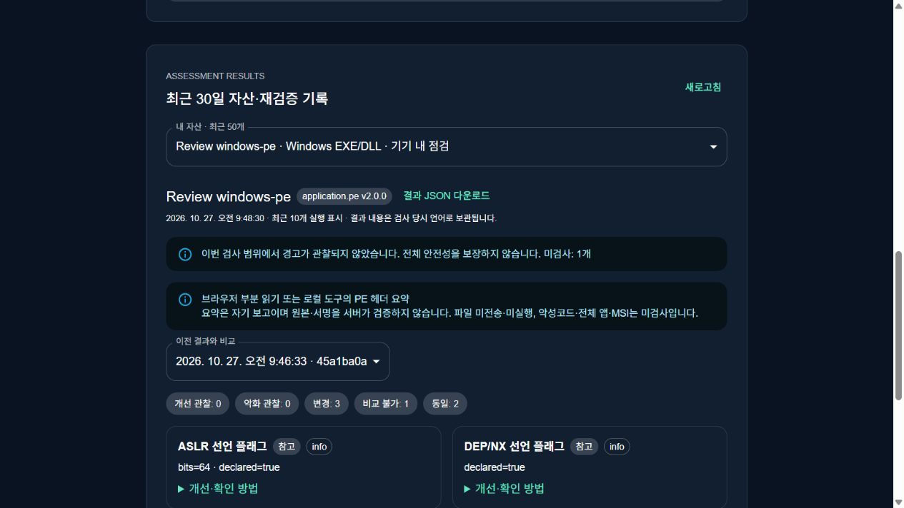

#### linux — 취약 선언 / 보완 선언

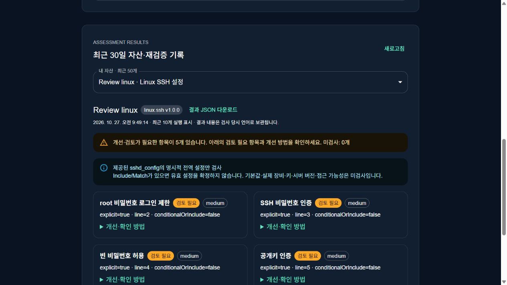

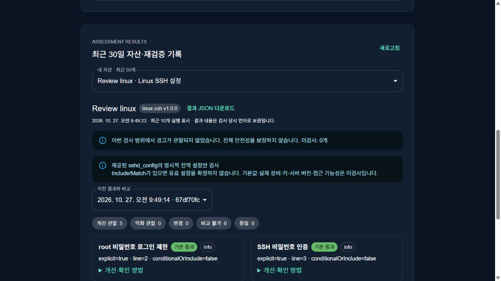

#### windows — 취약 선언 / 보완 선언

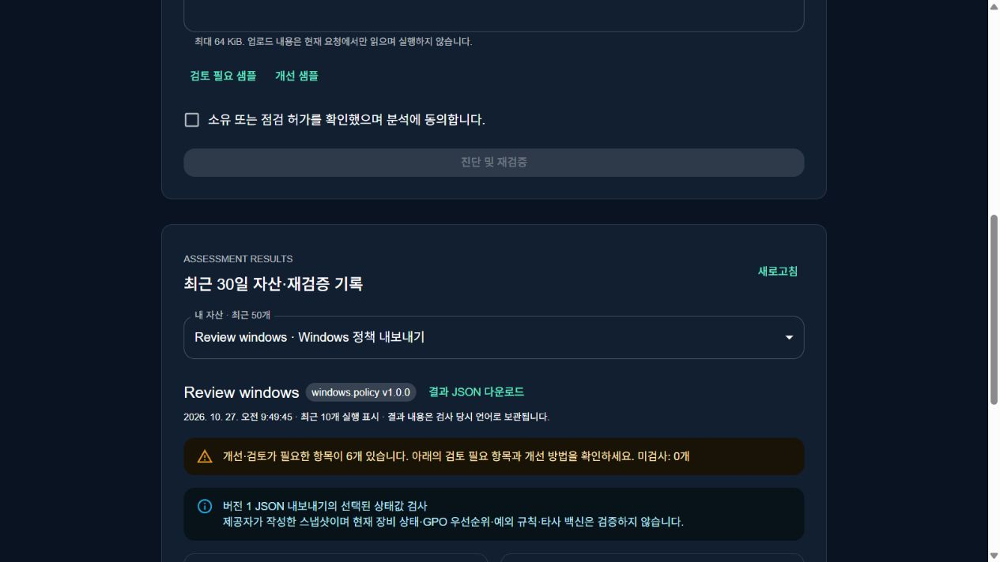

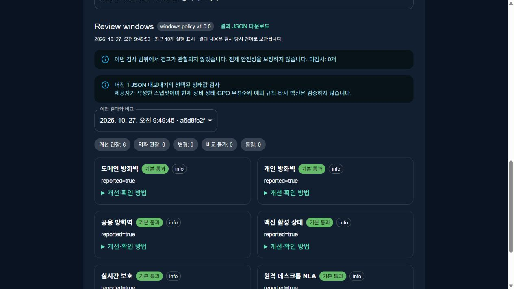

#### macos-macho — 취약 선언 / 보완 선언

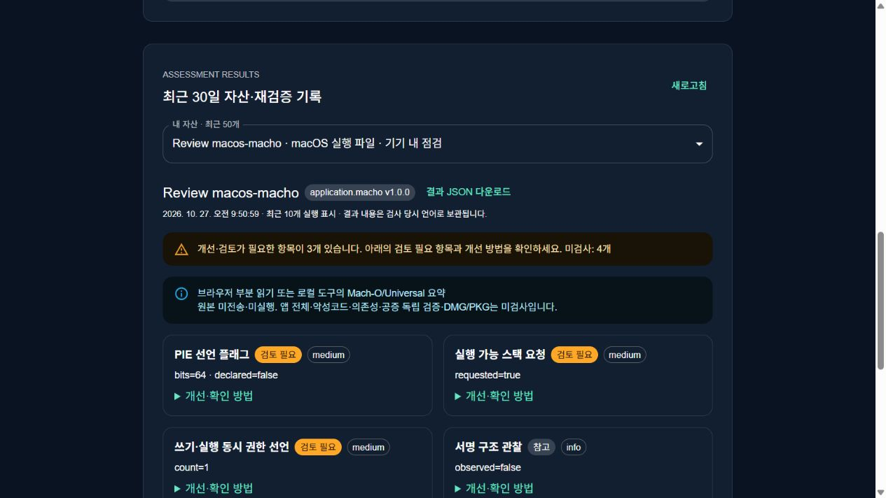

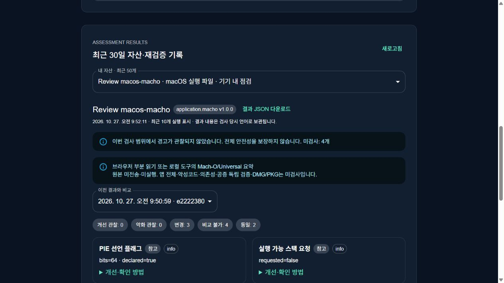

#### android — 취약 선언 / 보완 선언

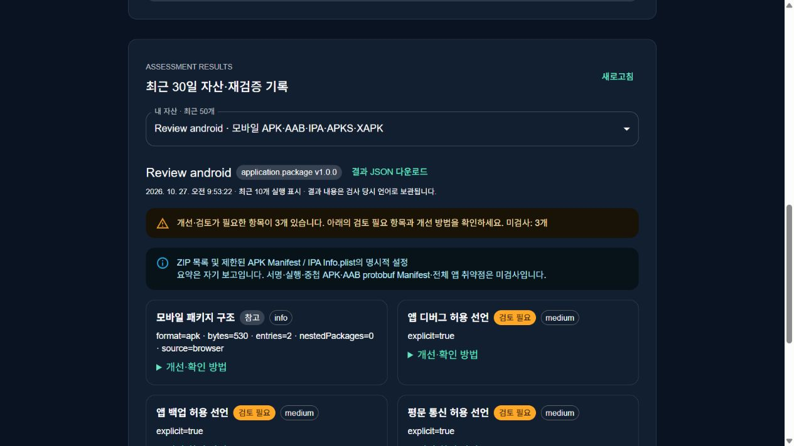

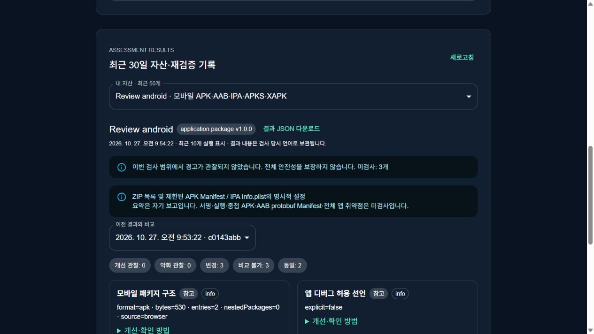

#### ios — 취약 선언 / 보완 선언

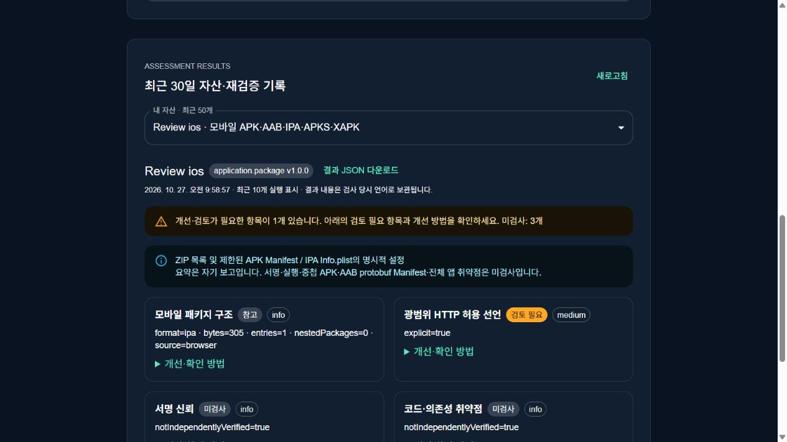

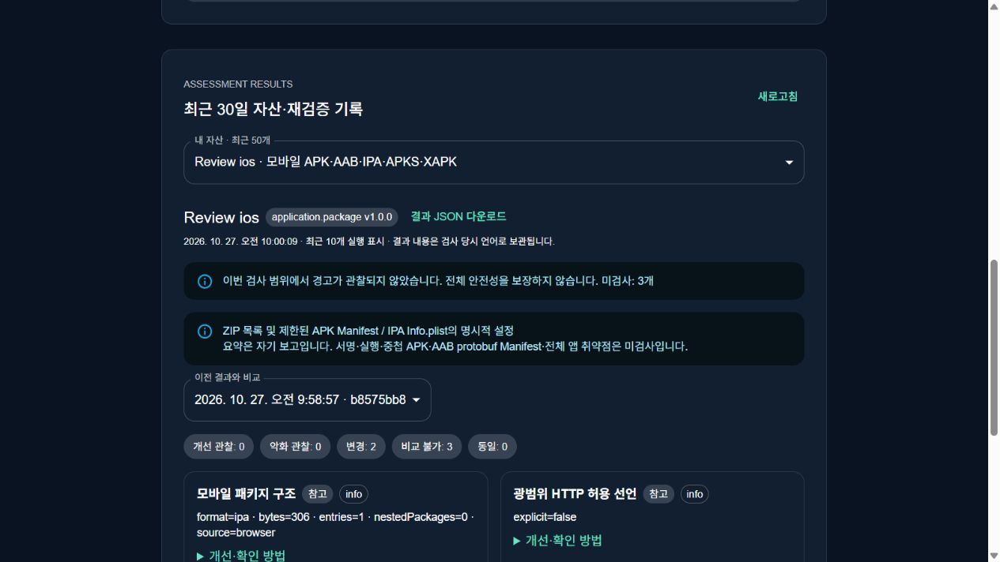

#### vmware — 취약 선언 / 보완 선언

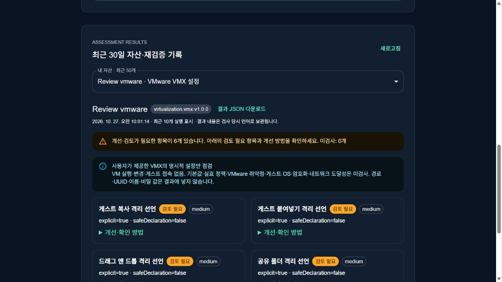

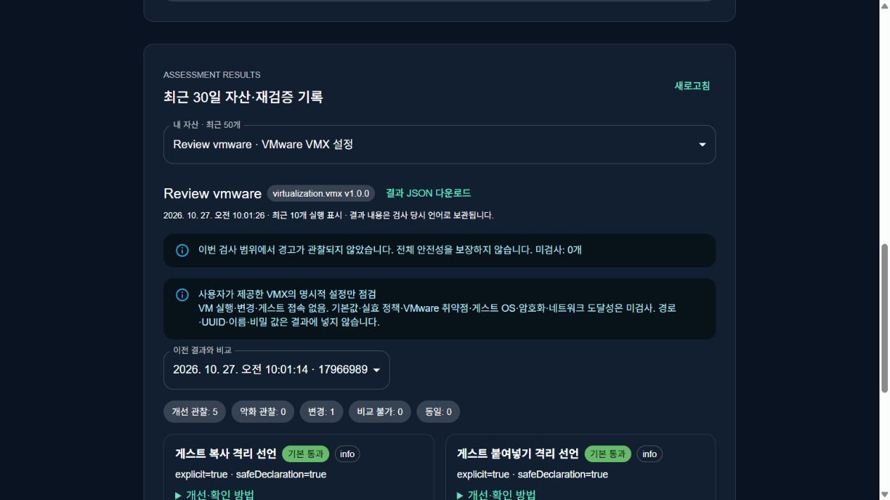

#### gns3 — 취약 선언 / 보완 선언

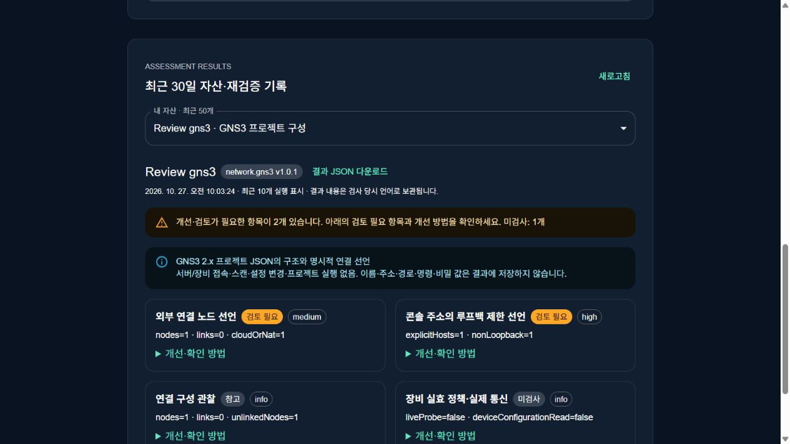

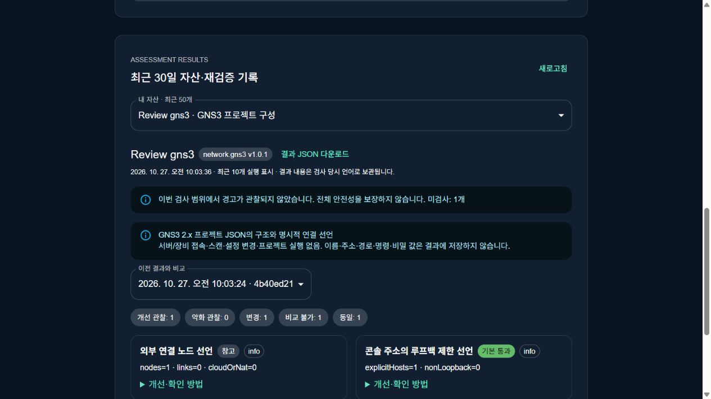

#### GNS3 3.0.0 입력 거절

오류 안내 후 기존 2.2.61의 성공 결과/시각이 유지됨을 확인했다. 지원하지 않는 입력으로 성공 기록을 덮지 않는다.

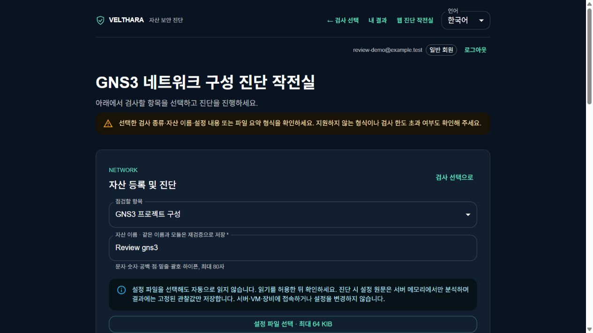

### 11.4 회귀·코드 검토·교차 확인

- 전체 자동 테스트 **117개 통과, 실패0**, 취약/보완 파일 8쌍 회귀 포함. R05/R07/CSP/신뢰 peer 경계의 새 검증 포함.
- production 검증 빌드 TypeScript 포함 통과. 최초 제한 환경의 빌드 디렉터리 EPERM 후 권한을 갖춘 재실행으로 해결. 추가 fixture 테스트의 암시적 배열 타입 오류를 명시적 AssessmentReport[]로 수정한 뒤 빌드/테스트 재통과.
- 실제 사용자 DB를 사용하지 않는 전체 API/DB 통합 통과: 회원 권한·계정 격리·저장·전후 비교·집계·보관·롤백·비밀번호 복구·일반/관리형 스키마. 관리형 테스트는 자체 임시 PG이므로 제공자 ACL 검증이 아님.
- HTTP 보안 smoke 통과: 모든 script의 응답 nonce 일치·새 문서 nonce 교체·미인증·교차 Origin 거절. 6개 언어 smoke 통과.
- 브라우저 8쌍의 경고 수가 독립 파일 파서/엔진 결과와 일치. GNS3의 실제 다운로드한 DB 저장 결과 findings/moduleVersion이 독립 결과와 완전히 같음을 확인.
- 모든 사진은 CUA로 실제 페이지를 촬영했다. 파일 선택 도구 이벤트/대기 시간 오류가 몇 차례 있어 현재 UI를 다시 확인한 뒤 정상 완료했으며 이를 제품 입력 실패라고 집계하지 않았다. 최종 파일 검사/저장은 정상 완료했다.
- 검토한 제품 변경: proxy/layout/보안 헤더, 로그인·가입/로컬 gateway peer, GNS3 parser, readiness. 기존 인증 UI·SSRF·IP 차단 우회·운영 자격·적용된 migration은 수정하지 않았다. 스타일 inline 및 관리형 권한 경계는 잔여 위험이다.

### 11.5 실제 대상별 상태와 2단계 판단

| 대상 | 이번 완료한 것 | 별도 컴퓨터에서 필요한 것 |
|---|---|---|
| Linux | 5지시어 합성 전후·API·브라우저 | 실제 배포판/OpenSSH, Include/Match, sshd -T 유효 설정과 사용자 조건 대조·다른 컴퓨터 로그인/저장 |
| Windows | 정책/PE 합성 전후, 기존 실제 PE 구조 이력은 이전 문서 | 실효 정책/GPO/예외·OS 서명 도구·실제 승인 파일 대조 |
| macOS | 브라우저 Mach-O 합성 전후, unknown4 유지 | 실제 Mac의 codesign/Gatekeeper/entitlement 및 로컬 도구 대조 |
| Android/iOS | APK/IPA 선언 합성 전후 | 승인된 실제 앱·플랫폼 분석 도구 대조. 설치/런타임·서명은 별도 범위 |
| VMware/GNS3 | 정적 VMX/GNS3 합성 전후·미지원 버전 거절 | 실제 저장 파일과 설치 버전, 격리 실습의 통신/설정 대조. 10/23 과거 실습은 재검증과 구분 |
| 운영 | 현재 공개 경로 200 재관찰·이전503 요청 대조 | 당시 runtime/DB 지표·다른 실제 기기 계정 흐름·간헐적 오류 추적 |

**판단: 1단계 완료·2단계 진행 중을 유지한다.** 지원 파서와 사이트 흐름의 합성 교차 검증은 완료했지만 실제 플랫폼 검증·R01 근본 원인·R02 제공자 권한/복구 확인은 남았다. 실제 검증이 없는 항목을 더미 자료로 완료 처리하지 않는다. Cloud/Container/IoT·전체 장비 진단은 여전히 미구현이다.

다음 컴퓨터에서 전달할 실행 프롬프트는 [PHASE2_OTHER_COMPUTER_PROMPT.md](PHASE2_OTHER_COMPUTER_PROMPT.md)에 있다. 환경이 있는 대상만 읽기 전용으로 검증하고, 없는 대상은 설치/추정하지 말고 사유를 기록하도록 정리했다.

## 12. 현재 PC 실환경 후속 검증 — 소스 e195d85

사용자가 지정한 PHASE2_OTHER_COMPUTER_PROMPT.md를 기준으로 이어서 검증했다. 이전 1~11절은 당시 결과로 보존한다. 이번 시작 시 작업 트리는 깨끗했으며 제품 코드·운영 DB·배포 설정을 변경하지 않았다.

### 12.1 이번 실행과 설치 상태 정정

- 현재 소스에서 자동 테스트 **117개 통과 / 실패 0**를 재확인했다. 11절의 빌드·임시 DB·브라우저 검증은 이전 근거이며 이번 재실행으로 표기하지 않는다.
- VMware Workstation **16.1.2 build-17966106**, GNS3 서버 실행 파일 **2.2.61**, Tera Term **4.80** 설치를 확인했다. “설치되지 않아 불가”가 아니다. 초기 실행 VM 0대에서 이후 CentOS 1대 실행, 더 늦게 VM 프로세스 2개 관찰로 상태가 바뀌었다. VMware UI에서 Kali·Ubuntu·GNS3 VM 등 등록 항목도 확인했다.
- 사용자가 연결한 뒤 프로세스에서 Kali root SSH Tera Term 창을 확인했다. Windows SSH와 Tera Term은 인증/known_hosts를 자동 공유하지 않는다. 기존 CLI 경로로 StrictHostKeyChecking + BatchMode 접속을 시도했으나 호스트 키 미등록으로 접속 전 중단했다. 호스트 확인 해제·새 키 저장·SSH 설정 변경은 하지 않았다.

### 12.2 실제 파일·플랫폼 교차 확인

- 기존 Linux VM의 **실제 VMX 3개**, 기존 **GNS3 프로젝트 2개**를 현재 엔진으로 검사했다. VMX는 누락된 공유/격리/VNC 5항목을 미검사로 유지하고 네트워크 선언은 info로 표시했다. GNS3 프로젝트 버전 **2.2.55 / 2.2.61**을 모듈 **1.0.1**이 수용했다. 콘솔 주소 누락과 장비 실효 정책은 미검사로 유지했다. 실제 ping·장비 ACL·격리 검증을 완료한 것은 아니다.
- 실제 Windows 시스템 PE를 읽기 전용으로 검사했다. 64bit, 360448바이트, W+X 0. 독립 OS 서명 조회는 **Valid**였지만 로컬 도구의 Windows PowerShell 자식 프로세스는 서명 모듈 자동 로드에 실패해 **unknown**을 반환했다. 권한 있는 재실행도 같은 결과였다. 엔진은 서명을 **not_assessed**로 유지했으며 unknown을 강제로 통과시키지 않았다. 서명 유효성은 악성코드 부재를 보증하지 않는다.
- Windows 정책 exporter는 현 실행 정책으로 차단됐다. 정책 JSON은 생성되지 않았으며 정책 우회나 Windows 보안 설정 변경을 하지 않았다. WSL 실행 환경·기본 Android SDK는 없고 실제 Mac/모바일 검증도 미완료다.

### 12.3 산출물과 남은 검증

익명화한 [실환경 검증 기록](validation/2026-10-27-local-environment/README.md)과 [파서/엔진 관찰 JSON](validation/2026-10-27-local-environment/observations.json)을 추가했다. 원본 설정·개인 경로·주소·계정·해시는 보고서에 넣지 않았다. 로컬 원본 snapshot은 Git 제외 work/에만 둔다.

| 상태 | 결과 |
|---|---|
| 구현 검증 완료 | 117개 회귀, 실제 VMX/GNS3 파일 처리, 실제 PE 구조와 미검사 보존 |
| 실환경 검증 완료 | Windows OS/도구/독립 서명, VMware 실행 상태, 실제 저장 파일 관찰 |
| 보류 | Linux sshd -t/-T/Include/Match 및 조건별 비교, Windows 정책/서명 도구 환경 차이, GNS3 통신·격리, 다른 실제 기기의 계정별 저장/조회, Mac/모바일 실환경, R01·R02 잔여 확인 |

Linux 읽기 전용 명령을 사용자에게 전달하고 결과를 기다리고 있다. 제품 장애로 확인되지 않은 환경 제한은 코드 수정으로 숨기지 않았다. **1단계 완료·2단계 진행 중**을 유지하며 Git push·운영 배포·DB 변경은 하지 않았다.

### 12.4 Kali 실제 콘솔 출력 수신 후 교차 검증

위 결과 대기 상태 이후 사용자가 기존 Kali SSH 콘솔의 읽기 전용 명령 출력을 제공했다. **사용자 제공 실환경 출력**이며 에이전트가 직접 수집한 게스트 출력과 구분한다. 기록 시각은 2026-10-27 07:20:42 UTC / 16:20:42 KST이며 게스트 자체 실행 시각은 제공되지 않았다.

- Kali GNU/Linux Rolling **2026.1**, **OpenSSH_10.3p1 Debian-1**, OpenSSL **3.5.5 27 Jan 2026**. `sshd -t` 종료 코드 **0**으로 해당 실행의 설정 문법 검증 통과.
- `sshd -T`의 지원하는 다섯 값만 별도 검토용 사본으로 현재 `linux.ssh` 1.0.0 엔진에 입력하고 기대 판정과 assertion으로 대조했다.

| 유효 지시어 | 관찰값 | 엔진 결과 |
|---|---|---|
| PermitRootLogin | yes | warning |
| PasswordAuthentication | yes | warning |
| PermitEmptyPasswords | no | pass |
| PubkeyAuthentication | yes | pass |
| MaxAuthTries | 6 | warning — 모듈 검토 기준 1~4 초과 |

**경고 3개 / 통과 2개**, 기대 결과와 일치했다. 문법 통과는 보안 정책 통과가 아니며 공개키 인증 활성 선언은 승인 키/복구 접속의 실제 성공을 증명하지 않는다. 현재 root 비밀번호 SSH 접근을 바로 끄면 접속을 잃을 수 있으므로 실제 설정을 변경하거나 서비스를 재시작하지 않았다.

출력에 `Include` 존재를 확인했다. 원본 전체와 재귀 Include 대상, 연결 조건별 `sshd -T -C`는 검증하지 않았다. 제공된 검색 출력에 Match가 없다는 사실만으로 모든 포함 파일의 조건부 설정 부재를 확정하지 않는다. 별도 구성한 **비식별 Include 표식 + 다섯 값**은 파서 경계 시험에서 5개 모두 not_assessed임을 확인했다. 이것은 원본 파일 업로드 검증이 아니다.

근거: [Linux 유효 설정 대조 JSON](validation/2026-10-27-local-environment/linux-effective.json). Linux의 배포판/버전·문법·기본 유효 다섯 값 대조는 사용자 제공 출력 기반으로 완료했다. 원본/조건별 설정·다른 기기 계정 저장·조회는 계속 보류이며 2단계 전체 완료로 변경하지 않는다.

## 13. 모든 파일 입력 검사 — 서버 수신 입력과 결과 연결

사용자 요청에 따라 클라이언트 요약을 검증된 원본 결과처럼 취급하지 않도록 신뢰 경계를 추가했다.

- PE/Mach-O/모바일 패키지: 원본 전송 별도 동의를 받는 **서버 원본 검증 · 최대 2 MiB** 선택 모드 추가. 서버가 수신 바이트를 재분석하고 직접 계산한 SHA-256·크기를 저장한다. 클라이언트 snapshot이나 integrity 주장을 함께 보내면 거절한다. 입력 실행·AI 전송·원본 DB 저장 없음.
- 기존 원본 미전송/로컬 JSON은 `unverified-summary`. 파일 일치 미검증 경고를 표시하고 서버 검증으로 승격하지 않는다. 최대 8 GiB 브라우저 부분 검사 기능은 유지한다. 대용량 서버 원본 검증은 지원하지 않는다.
- Linux/Windows 정책/VMX/GNS3는 서버가 이미 분석하던 **수신 UTF-8 텍스트**에 해시·바이트 수를 추가했다. 디코딩된 텍스트 해시이며 로컬 원본 파일 바이트의 증명과 구분한다. 기존 APK 서버 모드에도 수신 바이트 근거를 추가했다.
- 검증 상태/입력 근거가 다른 이력은 자동 개선·악화 비교를 하지 않는다. 과거 메타데이터 없는 파일 결과는 원본 검증으로 간주하지 않는다. UI의 준비 상태와 서버 검증 완료를 구분하고 파일/모드 변경·취소 시 원본 준비 상태와 동의를 초기화한다.
- **검증 한계:** 서버 수신 파일에 결과를 연결할 뿐 기기의 다른 파일, 배포자 진위, OS 서명 체인, 악성코드 부재를 보증하지 않는다. 사용자 제공 원본 자체가 다른 파일이면 그 파일의 새로운 해시/분석 결과가 생성된다. 서버가 모르는 기기 원본을 알고 있다고 주장하지 않는다.

검증: 자동 테스트 **118/118 통과**, 타입 검사 통과. 실제 PE/Mach-O/APK fixture 바이트 재분석·해시 대조, 조작 snapshot/검증 표시·미동의 플래그·손상·크기 초과 거절, 설정 4종 수신 텍스트 해시 대조, 검증 방식 혼합 비교 차단을 확인했다. loopback 임시 PostgreSQL의 실제 HTTP 통합에서 일반 회원 원본 저장·서버 해시·위조 거절 후 기존 이력 보존·타 계정 404·원본 base64 미저장을 확인했고 전체 통합도 통과했다. 사용자 DB와 운영 배포는 변경하지 않았다. 브라우저에서 새 모드의 실제 클릭 흐름 재검증은 아직 하지 않았다. 최초 제한 환경 빌드 EPERM 후 분리된 검증 빌드는 통과했으며 최종 추가 변경의 분리 production 빌드도 통과했다.

## 14. 클라이언트 비신뢰 경계 추가 검토

공통 JSON 요청 파서에 전체 본문 읽기 10초 제한·중단 시 스트림 취소·잘못된 UTF-8 거절을 추가했다. 검사 요청의 알려진 문자열 필드도 잘못된 타입을 조용히 무시하지 않고 거절한다. 원본/결과/계정/검증 주장을 클라이언트가 섞어 보내는 입력을 거절한다.

검사 API에 기존 계정별 5회/분과 별도로 신뢰 출처별 60회/분·글로벌 300회/분을 적용했다. 기존 Vercel 신뢰 주소 또는 로컬 서명 peer를 사용하고 임의 IP 헤더는 신뢰하지 않는다. 직접 next 실행처럼 신뢰 peer가 없으면 공통 미확인 출처 버킷을 사용한다. 공유 NAT와 글로벌 예산으로 정상 사용자도 제한될 수 있다.

추가 후 자동 테스트 119개와 타입/검증 빌드 통과, 분리된 실제 임시 DB 전체 통합 재통과. 세션·소유자 조건·runtime DB 권한·Origin·SSRF·로그아웃·계정 격리·잘못된 요청 거절의 기존 통합을 유지했다. 모든 보안이 해결됐다는 판단은 하지 않는다. 도메인 소유권은 기존처럼 사용자 선언이며, 기기 원본 증명·서버 자체 침해·제공자 ACL·R01 원인·인증된 장비 수집·맬웨어 분석·운영 탐지는 별도 잔여 범위다.

## 15. 웹 기술 관찰·PHP2Shell 및 프레임워크 권고

2026-10-27 공식 출처를 조회해 PHP2Shell 두 CVE를 확인하고 [기술/보안 권고 문서](WEB_TECHNOLOGY_ADVISORIES.md)의 카탈로그를 추가했다. 기존 HEAD 응답에서 PHP/Python/Django/Java/Spring/JavaScript·TypeScript/Next.js/RSC/.NET/Ruby/Node.js/Go 흔적을 분류한다. 기존 웹 기본 결과와 전용 웹 PC/모바일 결과 양쪽에 표시하며 moduleVersion 1.1.0으로 이전 결과와 자동 비교 경계를 유지한다.

PHP2Shell 2개 CVE·Django SQL injection·Spring4Shell의 확인한 분기 버전을 대조하며 Next.js/RSC는 패키지 버전 미확인으로 React2Shell 적용 여부를 미검사로 남긴다. 범위 밖 버전은 안전 통과가 아니며 숫자 버전 일치도 실제 공격 성공이나 백포트 미적용을 증명하지 않는다. 다른 제품별 전체 CVE 피드/서버 내부 의존성 확인은 미구현으로 표시한다. 숨김 기술은 미검사다.

PHP 분기 경계·버전 충돌/미확인·비밀 배너 제외·오류 응답 미검사·프레임워크 구분을 회귀에 추가했다. 모의 HTTPS transport → 실제 scanner → PC/모바일 엔진까지 PHP2Shell 4개 경고를 대조했다. 공격/추가 탐색 요청은 보내지 않는다. 전체 자동 테스트는 122개 통과, 최신 제품 빌드 통과. 이후 충돌 처리 보완의 관련 회귀/타입/최종 빌드도 확인한다. 실제 새 UI 클릭/운영 배포는 아직 수행하지 않았다.

## 16. 차단 정책 재확인과 관리자 IP 해제 관리

현재 IP 정책은 **5분 임시 차단 5회, 해제 후 6번째 위반에 영구 IP 블랙리스트**다. 차단 중의 요청은 누적하지 않는다. 정해진 URL 탐색/삽입/경로 이탈 패턴만 감지하며, 모든 공격 판별·공격자의 실명/원래 IP 역추적을 구현한 것은 아니다. 신뢰 peer/Vercel의 접속 IP를 기준으로 한다. VPN/프록시/공유 NAT와 공격자 신원은 별개다. `/api/health`, `/api/ready`는 보호 상태 조회 예외이며 보호 DB 오류는 503으로 닫힌다.

기존 PostgreSQL `public.ip_blocks`를 그대로 사용한다. 일반 PG migration 005, 관리형 스키마 001에 존재한다. 이번 기능은 새 DB 테이블이나 migration 없이 구현했다. 실제 운영 DB 카탈로그를 이번에 직접 재조회한 것은 아니다.

이전에는 관리자 로컬 복구 스크립트만 있었으나, 관리자 웹 기본 작전실의 위험 접근 패널에 **IP 차단·누적 경고 해제** 버튼과 `/api/admin/ip-blocks` POST를 추가했다. 서버에서 관리자 현재 역할·세션·Origin·요청 타입/필드·IP·요청 한도를 검증한다. 일반 회원/비로그인/교차 출처/클라이언트가 주장하는 관리자 ID는 수락하지 않는다.

해제는 삭제가 아니라 누적 0·영구 차단 false·만료 null·manual_reset 변경이다. 기존 events에 실제 관리자 user_id·DB 생성 시각·정규화된 대상 IP의 SHA-256 감사 식별자를 같은 SQL 문으로 남긴다. 감사 쓰기가 실패하면 해제도 롤백한다. 대상 IP는 기존 차단 테이블에 남고 감사 category에는 원문 IP를 넣지 않는다. 자동 일괄 해제는 없다. 관리자 자신의 접속 IP가 차단된 경우 웹 우회 예외는 만들지 않았으며 기존 승인된 별도 접속 경로나 로컬 복구 스크립트가 필요하다.

**계정 ID 블랙리스트는 아직 미구현**이다. 로그인 입력 아이디만으로 계정을 자동 차단하면 타인 계정 차단 공격이 가능하므로 추가하지 않았다. 요구한 계정 단위 정책을 완성하려면 별도 보관 테이블/migration·유효 세션에 귀속된 근거·로그인 차단/기존 세션 폐기·관리자 해제를 함께 설계/검증해야 한다. IP 해제로 계정까지 해제된다고 표시하지 않는다.

자동 테스트 123개·타입·관리 API를 포함한 production 검증 빌드 통과. 기존 임시 DB의 5회/6번째·동시성·차단 중 비누적·로컬 해제·계정 격리 통합은 통과했다. 새 관리자 API의 실제 HTTP 권한/감사/롤백/영구 해제 통합도 별도 실행한다. 운영 차단을 직접 해제하거나 배포하지 않았다.

## 17. 후속 완료: 계정 블랙리스트와 관리자 복구

이하 내용은 16절의 당시 미구현/예정 상태를 갱신한다. 기준은 e195d85 이후 로컬 작업본이며 운영 배포나 운영 DB 변경은 하지 않았다.

일반 PostgreSQL 011 / 관리형 007 migration에 account_blocks를 추가했다. 새 IP 위반이 발생했을 때 서버가 유효한 세션으로 확인한 계정에만 위반을 귀속한다. 위조·만료·중복 쿠키나 입력한 이메일만으로 다른 고객을 차단하지 않는다. 계정 자체 누적 6번째에 영구 차단하며 기존 세션 폐기, 로그인 거절, 요청별 차단 상태 확인을 함께 적용했다. 익명 상태의 과거 IP 위반은 로그인 계정으로 이전하지 않는다.

관리자만 IP 및 계정 누적/차단을 해제할 수 있다. 계정 해제 후 새 로그인이 필요하며 IP 차단은 별도다. 관리자 역할·Origin·엄격한 본문·한도를 서버에서 확인한다. 해제와 감사 입력은 원자적으로 처리하며 감사 실패 시 해제도 롤백한다. 임시 PostgreSQL/HTTP에서 동시성, 5회 임시/6번째 영구, 세션 폐기, 해제 후 로그인, 회원의 관리 API 거절을 검증했다. 테스트 관리자 브라우저에서도 실제 해제와 목록 갱신을 확인했다.

## 18. 민감정보 노출 경계와 서버 참조

일반 PG 012 / 관리형 008 migration으로 차단 행별 management_id를 추가했다. 관리자 응답에도 원문 IP/계정 UUID를 보내지 않고 마스킹된 주소·이메일과 관리 참조만 보낸다. 해제 요청은 blockId로 보내며 서버가 실제 대상을 조회하고 권한을 다시 확인한다. 참조값 자체는 인증 수단이 아니다.

일반 사용자 프로필은 마스킹 이메일·역할만 직렬화한다. 원문을 CSS로 감추거나 hidden/aria/RSC/JSON에 함께 넣는 방식이 아니다. 감사 대상 해시는 대시보드에서 고정 분류로 정규화한다. 실제 검사 결과·파일 해시·사용자 본인 자산 결과는 정확성을 유지하며 고객별 서버 소유권으로 보호한다. 세션 쿠키는 브라우저 인증을 위해 존재하되 HttpOnly 등으로 보호하며, 고객 본인 연동 토큰은 발급 시 전달이 필요하다. DB 자격과 혼동하지 않는다.

근거: [노출 경계](DATA_EXPOSURE_BOUNDARY.md), [관리 정책](BLACKLIST_MANAGEMENT.md), [마스킹 화면](validation/2026-10-27-local-environment/admin-masked-management.png), [관리자 해제 성공](validation/2026-10-27-local-environment/admin-reference-release-success.png).

## 19. 일반 고객 기능 교차 검증과 잔여 범위

관리자가 아닌 실제 신규 가입 viewer 계정을 사용했다. 일반 회원도 지원하는 고객 진단 기능에 접근하도록 유지했다. 관리자용 차단 목록/해제는 403이며 다른 고객 데이터 접근도 거절한다.

- Linux SSH, Windows 정책, PE, Mach-O, APK/IPA 패키지, 기존 APK, VMX, GNS3: 8개 고유 오프라인 모듈을 9개 fixture 사례의 개선 전후 18회 저장으로 검증했다. 같은 자산 재검증 이력·서버 계산 해시·다른 계정 접근 거절을 확인했다. 기존 APK의 미검사 항목을 안전 통과로 바꾸지 않았다.
- 일반 회원 브라우저: 파일 없음 오류, 읽기 동의 전 검사 비활성, 파일 분석·저장·상태 초기화, JSON 다운로드와 미검증 요약 경고를 확인했다. 관리자 브라우저에서는 별도 동의 후 원본 서버 재분석과 SHA-256도 확인했다. 파일은 임시 로컬 서버에서만 테스트했다.
- 일반 회원 웹 비교: PC/모바일 공개 루트 HEAD 200, 기술 흔적·버전 미확인·CVE 적용 여부 미검사를 표시했다. 기본 웹 검사도 본인 결과 저장과 타 계정 격리를 확인했다.
- 일반 회원 본인 연동 토큰 발급/교체, 이전 토큰 거절, 새 토큰 집계 2회, 기록에 원문 토큰 없음, 타 계정 교체 거절을 확인했다. AI는 실제 외부 제공자 대신 로컬 모형에서 본인 결과·캐시·타 계정 거절을 검증했다.
- 실제 5회/분 제한에 도달하면 60초 대기 후 검사를 이어갔다. 한도를 우회해 통과시키지 않았다.

기본 웹 검사에서 일시 400이 관찰된 후 재시도는 200이었다. 최초 원인을 확정하지 않았다. 별도로 통제된 6.5초 지연 HEAD 회귀는 기존 5초 제한에서 실패했고, 헤더 대기를 15초(전체 검사 20초)로 조정한 후 통과했다. DNS/SSRF/인증서 검증은 유지했다. 실패 로그는 고정 사유만 남긴다. 이 결과만으로 운영 PROTECTION_UNAVAILABLE 원인이 해결됐다고 단정하지 않는다.

최신 자동 회귀 127/127, TypeScript, 분리 production 빌드 통과. 실제 DB/HTTP 통합은 최종 재실행 로그를 별도로 확인한다. 일반 회원 서비스 증거: [검증 JSON](validation/2026-10-27-local-environment/member-services.json), [회원 홈](validation/2026-10-27-local-environment/member-home.png), [회원 파일 결과](validation/2026-10-27-local-environment/member-browser-result.png).

Cloud/IoT/Container는 준비 중이며 고객·관리자 모두 완성 기능으로 표시하지 않는다. 실제 macOS/모바일 기기 검증, Windows 정책 추출 제한, 관리형 제공자 ACL, 전체 언어/전체 CVE, 운영 접속 오류 원인은 잔여 범위다. 공개 웹의 헤더만으로 숨겨진 모든 언어나 실제 취약성을 확정할 수 없다. 브라우저 요약/서버 수신 바이트 검증도 고객 기기의 원본 파일 진정성을 증명하지 않는다.

**운영 반영 전:** 해당 DB 종류의 신규 migration(일반 011·012 또는 관리형 007·008), runtime 권한, readiness를 먼저 확인해야 한다. 현재 단계는 Phase 1 완료 / Phase 2 진행 중이다. 이 후속 작업에서는 커밋·푸시·운영 migration·배포를 하지 않았다.

마지막 UX 점검에서 Linux/Windows 설정 파일 선택 직후 읽기 흐름을 수정했다. 파일 선택은 내용 읽기를 시작하지 않고, 선택한 파일별 읽기 동의와 '허용한 설정 읽기'가 필요하다. 파일 변경·직접 입력·모듈 변경 시 읽기/진단 동의를 초기화한다. 이 추가 수정은 타입·최종 빌드로 확인하며 앞의 브라우저 파일 동의 실증은 PE 경로에 대한 것이다. Linux/Windows 새 동의 UI 자체의 브라우저 재실행은 별도 확인 범위로 남긴다.

| 대상 | 판정 | 근거 / 남은 확인 |
|---|---|---|
| 일반 회원의 지원 진단·저장·조회·재검증·고객별 격리 | 구현 검증 완료 | 임시 DB/HTTP 모듈 행렬 및 회원 브라우저 PE·웹 비교 |
| 서버 수신 원본 해시·요약 미검증 구분 | 구현 검증 완료 | 위조 혼합 요청 거절·원문 미보관·원본/요약 브라우저 결과 |
| IP/계정 차단·관리자 해제·민감 식별자 마스킹 | 구현 검증 완료 | 임시 DB 동시성/감사 롤백 및 관리자 브라우저 |
| 실제 VMware/GNS3 설치·제공 설정 관찰 | 실환경 검증 완료（기록된 범위） | 12절. 게스트 실효 설정 전체/네트워크 전체 검증은 아님 |
| Kali SSH 지원 지시어 | 실환경 검증 완료（제공 출력 범위） | 사용자 제공 유효 출력과 정적 엔진 대조. 원본 전체 업로드 아님 |
| Linux/Windows 추가 읽기 동의 UI | 구현 확인 / 브라우저 보류 | 타입·최종 빌드 통과, 두 UI의 선택→동의→읽기 실클릭 재확인 필요 |
| 실제 macOS/모바일·Windows 정책 전체 | 보류 | 해당 기기/도구·승인된 정책 추출 필요 |
| 운영 migration·배포 후 일반 회원 점검 | 보류 | 운영 변경 미실행. migration·권한·readiness 후 별도 점검 |
| R01 운영 간헐 오류·R02 제공자 권한 | 보류 | 발생 시각의 runtime/DB 근거 및 제공자 권한 점검 필요 |
| Cloud·IoT·Container | 보류 | 준비 중 기능으로 표시, 완성된 고객 진단으로 포함하지 않음 |

최종 재실행 결과: 임시 PostgreSQL/HTTP 통합 전체 종료 코드 0, 일반 PG·관리형 스키마 검증 및 30일 보관/백업·계정 격리·감사 롤백 통과. [비밀 없는 통합 결과](validation/2026-10-27-local-environment/final-integration.txt)에 PASS 항목을 보존했다. 마지막 읽기 동의 수정 후에도 타입 검사·production 빌드·127/127 회귀가 통과했다. 임시 브라우저 서버와 PostgreSQL을 종료했으며 운영 서비스에는 적용하지 않았다.

## 20. 사용자 후속 요청에 따른 운영 migration 적용

사용자가 개발 도구 없이 대신 진행해 달라고 요청하여, 검토 결과를 제시한 뒤의 운영 반영 작업을 이어갔다. 기존 로컬 운영 설정으로 DB 식별 일치를 확인했으며 비밀 값은 출력하지 않았다. 관리형 Prisma Postgres에 001~006이 적용된 상태였다.

첫 신규 migration 시도는 제공자의 `restricted superuser cannot grant or revoke privileges` 제한(42501)으로 전체 롤백됐다. 운영에 아직 적용되지 않은 신규 관리형 007의 REVOKE를 제공자 프로필에 맞게 제외했다. 일반 PostgreSQL 011의 REVOKE는 유지했다. 이후 관리형 007·008 적용 성공을 확인했다. 재조회에서 account_blocks와 IP/계정 management_id, migration 이력 8개, account_blocks의 PUBLIC 테이블 권한 없음이 확인됐다. 이는 제공자 관리 자격 자체의 과도한 권한 문제까지 해결했다는 뜻은 아니다.

기존 고객 결과 삭제·차단 해제·비밀번호 변경은 하지 않았다. 앞 절의 운영 migration 미실행 문구는 당시 상태이며 이 절로 갱신한다. 코드 업로드와 운영 배포 후 점검 결과는 아래에 후속 기록한다.

### 운영 배포 결과

기존 GitHub main에 코드 커밋 `5a4c521`을 정상 푸시했다. Vercel GitHub 상태가 `success / Deployment has completed`인 것을 확인했다. 배포 ID는 `DWuB6S44yRcetPLAox3yL1fJLX2r`이다. 운영 `/api/health`, `/api/ready`는 200, 새 관리 API 두 경로의 GET은 405(POST 전용), 동일 출처 비로그인 POST는 각각 401이었다. 실제 운영 차단 해제나 고객 결과 작성은 하지 않았다.

운영 로그인 세션을 사용한 고객 전체 시나리오는 이 배포에서 새로 수행하지 않았다. 앞 절의 일반 회원 전체 행렬은 격리된 로컬 환경의 검증이다. R01 최초 간헐 오류 원인·R02 제공자 권한과 실제 macOS/모바일 검증도 여전히 잔여 범위다. 고객이 사용할 개발 도구 없이도 기존 설정과 Git 연동으로 migration·푸시·배포 확인까지 대행했다.

## 21. 운영 일반 회원 시나리오 재검증 — 2026-10-27~28

사용자가 직접 일반 회원으로 로그인한 실제 운영 세션에서 검증했다. 화면과 API의 viewer 역할을 확인했다. 지원 진단 모듈 9개에 대해 파일/설정/웹 검사 결과 저장과 본인 조회가 성공했다. PE 실제 notepad.exe의 원본/브라우저 검사, Kali 제공 유효 출력 사본, Windows 정책 전후 6개 개선, Mach-O/APK/IPA/VMX/GNS3 합성 정적 검증, 웹 PC/모바일 200과 기본 웹 검사 200, JSON 다운로드를 확인했다. 실제 기기 검증과 합성 정적 검증은 구분한다.

운영 서버의 실제 PE SHA-256은 PowerShell의 독립 계산과 일치했다. 같은 자산의 이력 2건 및 무결성 방식 차이에 따른 자동 비교 제한도 유지됐다. 일반 회원의 실제 관리자 자산 조회는 SCAN_NOT_FOUND이며 데이터 배열을 반환하지 않았다. 본인 프로필 원문 ID와 관리자 IP/계정 목록은 일반 회원 응답에서 제외되고 이메일은 마스킹됐다.

본 검증 웹 자산의 수집 키는 발급 202, 교체 후 이전 키 401·새 키 202, 본인 집계 2건을 확인했다. 사용한 검증 키는 마지막 재교체로 폐기했고 원문 임시 파일은 제거했다. 기존 고객 키와 데이터는 삭제/변경하지 않았다. 검증 결과는 해당 회원의 별도 `운영 확인`·`운영 검증` 자산으로 남는다. 외부 AI는 운영 설정이 꺼져 있어 비활성 사유 표시만 확인했으며 외부 생성 성공으로 기록하지 않는다.

운영 검증 중 과거 무결성 메타데이터 없는 설정 결과에 지원하지 않는 서버 원본 모드를 권하는 안내와 좁은 화면의 긴 해시 가로 넘침을 발견했다. 이전 결과 전용 안내와 해시 줄바꿈으로 수정했으며 타입·production 빌드가 통과했다. 상세 결과와 미검증 범위: [운영 회원 검증 기록](validation/2026-10-27-production-member/README.md). 20절의 운영 로그인 후 미실행 상태는 위 범위에서 갱신한다. R01/R02, 실제 플랫폼/준비 중 기능, 운영 공격·차단 해제·보관 기간 조작은 검증 완료로 확대하지 않는다.

후속으로 기본 웹 진단 HTTP 200·기본 개선안 표시·진단 로그 다운로드·한/영 전환 및 한국어 복원을 운영에서 확인했다. 표시 수정 코드 `1dcbbc0`의 Vercel 배포가 성공했으며 health/readiness 200·관리 API 비로그인 POST 401도 유지됐다. 과거 Windows 정책 결과의 새 무결성 안내를 운영에서 확인했다. 검증 근거는 해당 validation 폴더에 추가한다.

## 22. 검사 결과를 일반 고객이 읽기 쉽게 개선 — 2026-10-28

요청: 부족한 보안 설정·주의할 이유·다음 조치를 이해하기 어렵다는 피드백을 반영했다. 판정 엔진이나 저장된 결과를 다시 작성하지 않고 화면 설명 계층을 추가했다.

- 상단에 '결과를 쉽게 보면' 요약을 표시하고 보완 항목과 미검사 항목의 수를 분리했다. 미검사만 있는 경우는 자료만으로 판단할 수 없다고 안내한다.
- 경고를 먼저, 같은 경고 안에서는 기존 심각도에 따라 높은 항목을 먼저 표시한다. 미검사·참고·기준 충족 항목은 별도 그룹으로 구분하며 나머지 항목도 펼쳐 볼 수 있다.
- Linux SSH·Windows 정책·실행 파일 보호·앱 통신/개발 설정·VMware 공유·GNS3 콘솔 등 기존 규칙에 대해 쉬운 제목, 무엇을 확인했는지, 왜 확인해야 하는지, 다음에 할 일을 기본 표시한다. 모르는 규칙은 기존 설명을 유지한다.
- raw enum(medium 등)·explicit=true 같은 값은 '기술 근거·담당자용 상세 보기'로 옮겼다. 원래 규칙 이름·근거·개선 지침·기준 문서는 보존한다.
- 입력 검증 여부는 쉬운 요약을 항상 표시하고, 긴 SHA-256 및 검사 범위 원문은 펼쳐 볼 수 있게 했다. 서버 수신 바이트 검증과 기기의 원본 진정성·악성코드·현재 실효 상태를 구분한다.

예: 'root 비밀번호 로그인 제한 / medium / explicit=true' 대신 '관리자 계정의 비밀번호 직접 접속'이라는 제목 아래 비밀번호 유출 시 영향과 담당자에게 요청할 사항을 설명한다. 키 인증이나 관리자 접속을 제한하기 전 복구 접속을 확인하라는 기존 안전 조건은 유지한다. 결과가 경고라는 이유로 실제 공격 성공·침해를 확정하거나 기준 충족을 전체 안전으로 확대하지 않는다.

관련 변경: app/workbench/assessment-findings.tsx, lib/assessment/explanation.ts 및 작전실 공통 결과 렌더링. 전체 작전실의 새 결과와 기존 결과에 적용되며 기본 웹 작전실의 별도 카드/AI 설명을 재작성한 변경은 아니다. JSON 다운로드와 비교 판정, DB·권한·진단 모듈 버전은 그대로다.

자동 회귀 130개(새 경고 우선순위·비변조·식별자 구분·미검사 CVE 안내 검증 포함)와 타입 검사 통과. 분리 로컬 실제 PostgreSQL/HTTP·일반 회원 화면에서 경고 3개/미검사 4개 Mac 정적 결과의 그룹 표시, 미검사 펼치기, 원본 기술 근거 펼치기를 확인했다. 합성 자료는 로컬에서만 사용했다. 최종 빌드 및 운영 재확인 결과는 후속 기록한다.

후속 완료: 최종 회귀 130/130·타입·production 빌드가 통과했다. 코드 08b4924 Vercel 배포 success와 health/readiness 200을 확인했다. 운영 일반 회원의 기존 Kali 결과에서 경고 3개를 쉬운 설명으로 표시하고, 기술 상세를 펼치면 원래 규칙·explicit/line 근거가 유지되는 것을 확인했다. 새 운영 파일 업로드나 결과 저장 없이 재조회로 확인했으며 로컬 임시 DB/서버는 종료했다. [실제 운영 화면과 검증 범위](validation/2026-10-28-readable-results/README.md)에 증거를 보존했다.

## 23. Android Chrome 실제 고객 확인 및 관찰값 중심 설명 보완 — 2026-10-28

사용자가 실제 Android Chrome에서 일반 회원으로 확인한 결과, 파일 미선택 검사 시 ‘검사할 파일을 먼저 선택해 주세요’ 안내가 표시됐다. 이어 제공한 모바일 화면과 ‘PC에 저장한 기록 보이는듯’ 답변으로 동일 계정의 PC 저장 결과를 휴대폰에서 조회한 사실을 교차 확인했다. 두 항목은 사용자 직접 실행·화면 제공에 따른 완료이며, 에이전트의 휴대폰 직접 조작이나 APK 서명·실행·기기 보안 검증 완료를 뜻하지 않는다. 개인 기기 화면 원본과 자산 식별자는 공개 저장소에 복제하지 않는다.

제공된 화면은 기존 운영 설명이다. 기준 충족 카드에서도 설정 추가를 요구하고 같은 일반 문장을 반복하는 표시 문제가 확인됐다. 후속 수정본은 실제 기록의 허용된 관찰값과 항목별 기준을 구분해 표시하고, 충족한 항목의 조치를 ‘유지·재확인’으로 표시한다. HTTP 상태, PC·모바일 응답 차이 수, CORS 관찰 범위, CSP/HSTS 및 인증서 값을 구체화한다. 옛 기록에 값이 없으면 확인 자료 추가·재검사를 요청하며 시스템 설정 자체가 없다고 추정하지 않는다. 이 절 작성 시 후속 수정본의 운영 배포·모바일 재확인은 아직 완료되지 않았다.

Windows 실제 정책 내보내기와 notepad.exe의 운영체제 서명 결과 대조, 자체 임시 GNS3/VPCS 토폴로지의 연결 노드 통신 및 미연결 노드 타임아웃은 제한된 범위에서 확인했다. 기존 VM 설정이나 고객 데이터를 변경한 검증은 아니다. R01 과거 오류의 정확한 원인, R02 운영 실행 계정 권한 분리·백업 복구 검증, 실제 macOS/iOS 및 Android 네이티브 검증은 완료로 변경하지 않는다.

## 24. 브라우저 내부 정보 최소화 및 React·Node.js 보안 권고 확대 — 2026-10-28

운영 브라우저 소스맵 생성을 명시적으로 끄고, 소스맵 주소 요청을 DB 보호 조회 전에 빈 404로 거절한다. API 응답에는 저장 금지·검색 노출 제외 헤더를 추가했다. 공개 readiness 응답은 준비 상태와 일반 코드만 반환하며 스키마·권한 모델 진단 정보를 제외한다. 고객의 브라우저에서 실행되는 코드·정당하게 수신한 본인 데이터는 개발자 도구에서 완전히 숨길 수 없다. 원본 미전송 검사 기능을 유지하며 우클릭 차단·디버거 방해·화면 마스킹만으로 비밀을 보호한다고 주장하지 않는다.

로컬 production 빌드의 브라우저 소스맵 및 sourceMappingURL 참조는 0개였다. 빌드 JS에서 확인한 DB 연결 문자열·개인키 패턴은 검출되지 않았다(일반적인 모든 비밀 부재의 증명은 아님). 로컬 production 서버에서 정적 경로 및 일반 경로의 .map 요청은 빈 404·no-store였고 health API의 저장 금지·noindex 헤더를 확인했다. 기존 회귀 134개와 해당 시점 production 빌드가 통과했다.

공식 공지를 확인해 React RSC의 CVE-2026-23864, 서버 함수 소스 노출 CVE-2025-55183, 10월 공개 GHSA-xqc2-xf4c-x3h3·GHSA-h3gv-c5rc-p453을 기존 React2Shell 검토에 추가했다. React·Next.js 헤더를 실제 react-server-dom 패키지 버전으로 간주하지 않으며, RSC·서버 함수 사용 여부와 정확한 배포 패키지 자료를 요청한다. GHSA만 공개된 항목에 CVE 번호를 임의로 붙이지 않는다.

Node.js는 1월 공지의 CVE-2025-55131·CVE-2025-55130·CVE-2025-59465와 10월 공지의 CVE-2026-111497·CVE-2026-105482·CVE-2026-105483·CVE-2026-106069를 추가했다. 정확한 Node.js 배너가 있을 때 공지의 해당 주요 버전 계열 수정 기준과 비교한다. Express 버전·접미사가 붙은 공급자 버전·충돌하는 버전은 실행 버전으로 추정하지 않는다. 미등록 계열은 미확인으로 남기며 수정 기준 이상도 전체 안전 판정으로 표시하지 않는다. 추가 공격 요청이나 취약점 페이로드 실행은 없다. 카탈로그와 웹 규칙 버전은 2026-10-28.1로 갱신했고 기존 결과는 재작성하지 않는다.

근거: [React 1월 공지](https://github.com/react/react/security/advisories/GHSA-83fc-fqcc-2hmg), [React 10월 RCE 공지](https://github.com/react/react/security/advisories/GHSA-xqc2-xf4c-x3h3), [React 10월 DoS 공지](https://github.com/react/react/security/advisories/GHSA-h3gv-c5rc-p453), [Node.js 1월 공지](https://nodejs.org/en/blog/vulnerability/december-2025-security-releases), [Node.js 10월 공지](https://nodejs.org/en/blog/vulnerability/october-2026-security-releases). 새 React·Node 비교 회귀는 정상/영향 버전 경계, 미확인 자료, Express 혼동 방지, 클라이언트 전용 React를 검증한다. 운영 반영 여부는 배포 후 별도로 기록한다.

후속: 커밋 4d6f6db의 GitHub 푸시와 Vercel 배포 success를 확인했다. 운영 health/readiness 200, 관리 API 비로그인 POST 401이 유지됐다. 최종 회귀 136개·타입·production 빌드 통과. 과거 기록 제거 작업을 진행하면 이 절의 커밋 번호는 변경 전 이력 식별자가 된다.

## 25. 사용자 제공 소스·의존성 정적 검토 추가 — 2026-10-28

URL 헤더만으로 사용자 코드의 언어와 실제 설치 패키지를 확인할 수 없다는 피드백을 반영했다. 웹 작전실에 PHP·JS·TS·JSX·TSX 및 package.json·package-lock.json·composer.json 한 파일(최대 UTF-8 64 KiB)을 명시적 동의 후 서버 메모리에서 확인하는 기능을 추가했다. 기본 웹 결과에서도 해당 검사 화면으로 이동할 수 있다. 파일 미선택·동의 전 자동 읽기/검사·원문 반환을 허용하지 않는다. 원문과 결과를 DB에 저장하지 않으며 결과는 현재 화면에서만 유지한다. 서버가 수신한 UTF-8 텍스트의 SHA-256을 표시하며 실제 원본 파일 바이트·실효 배포의 인증으로 확대하지 않는다.

문법 단서, React 코어, Next.js, react-server-dom-* 패키지와 Node/PHP 실행 버전 주장을 구분한다. JavaScript 문법이나 React 코어만으로 Node.js·RSC 사용을 단정하지 않는다. 버전 범위·서로 충돌하는 설치 버전·지원하지 않는 계열은 미확인으로 남긴다. 잠금 파일의 정확한 react-server-dom 패키지 버전은 등록된 React 권고별 수정 기준과 대조한다. 실제 배포·기능 사용·공급자 백포트는 별도 확인하며 정적 코드 전체 감사나 공격 성공 판정은 지원하지 않는다. 재귀 의존성 전체·다른 언어·모든 CVE를 지원한다고 주장하지 않는다.

일반 회원 임시 PostgreSQL/HTTP 교차 검증: 비로그인 401, 다른 출처 403, 미동의·빈 입력·지원하지 않는 필드 400, 정상 검사 200을 확인했다. 원문 비반환·서버 텍스트 해시·검사 결과 비저장을 확인했다. 브라우저에서 파일 미선택 오류, 선택 후 동의 전 검사 비활성, 동의 후 검사 결과와 정확한 버전 기준 표시를 확인했다. 화면 검사 중 소스 검토를 웹 응답 검사로 설명하는 공통 안내를 발견해 소스 전용 범위·해시 안내로 수정했다. 회귀 139개가 통과했으며 후속 변경의 관련 회귀 43개와 타입 검사도 통과했다. 운영 배포·수정된 화면의 최종 재확인은 별도 진행한다. 테스트 파일은 로컬 work/에서만 사용하며 운영 기본값·자산에 넣지 않는다.

## 26. 해당 GitHub 저장소 민감 정보 검사 및 환경 예시 이력 제거 준비 — 2026-10-28

origin을 갱신한 뒤 GitHub main의 39개 커밋에서 텍스트 blob 586개를 검사했다. 공개 heads/tags 조회 당시 main만 있었고 태그는 없었다. 개인키, GitHub/GitLab/API/AWS 키, JWT, DB 인증 URL, 자격증명 쿼리 및 현재 로컬 운영 비밀 값과의 일치 여부를 값 출력 없이 확인했다. 실제 비밀 값은 발견하지 못했다. DB URL 후보는 문서·테스트·과거 환경 예시의 합성 값이었다. 이는 현재 Git 기록의 제한된 패턴 검사이며 GitHub의 삭제된 숨은 참조·포크·Actions 로그·외부 캐시 전체 검증은 아니다.

현재 추적되는 .env 파일은 없다. 과거 .env.example·.env.migration.example은 빈 비밀 키와 예시 값으로 확인했지만, 사용자가 예시도 제외하라고 명시해 과거 기록에서 제거하는 작업 대상으로 정했다. .env 관련 무시 규칙은 모든 깊이에 적용되며 개인키·서명 저장소·로컬 클라우드 자격증명·DB 백업 파일 무시 규칙도 보강했다. 환경 예시 이력 제거는 커밋 식별자 변경과 원격 강제 갱신이 필요하므로 별도 사본의 결과를 확인한 뒤 최종 반영 여부를 기록한다. 운영 환경변수나 로컬 비밀 설정 파일을 삭제하는 작업은 아니다.

후속 완료: 사용자 승인 후 `.env*`뿐 아니라 `*.env*`·env.* 패턴으로 범위를 넓혀 deploy/의 예시 3종을 포함한 5개 경로를 과거 이력에서도 제거했다. 최신 코드 tree를 보존한 채 force-with-lease로 반영했고, GitHub 새 복제본의 40개 커밋에서 환경 파일 경로 0개를 확인했다. 로컬 main도 새 이력과 동기화했다. 최종 제거 기준 커밋은 84a3cab이다. 외부 복제본과 옛 SHA 캐시 삭제까지 완료한 것은 아니다. [검증 근거 및 운영 잔여 사항](validation/2026-10-28-source-review/README.md).

## 27. 운영 DB 휴면 연결 재사용 보완 및 최종 회원 재검증 진행 — 2026-10-28

운영에서 PROTECTION_UNAVAILABLE와 readiness 503을 다시 확인했다. Vercel 로그의 block_read는 약 11.5초 뒤 DB_QUERY_TIMEOUT으로 끝났고 한 번의 읽기 재시도도 실패했다. 서버 전용 readiness 진단은 DATABASE_CONNECTION_OR_PERMISSIONS_FAILED와 약 5.1초를 기록했다. 공개 응답은 일반 준비 상태만 유지한다. 같은 시점 로컬의 제공자 직접·풀링 연결 SELECT/인덱스 조회는 정상으로, 전체 DB 중단이나 특정 권한 문제로 확정할 근거는 부족했다.

기존 attachDatabasePool과 5초 idleTimeout을 유지하고, 휴면 중 타이머가 멈춰도 연결 반환 시각과 현재 시각을 비교해 5초 이상 쉬었던 연결은 SQL 실행 전에 폐기하도록 보완했다. 여러 클라이언트 폐기 시도도 제한하며, 차단 검사를 생략하거나 실패 시 허용하지 않는다. 오류난 쓰기 쿼리를 재실행하지 않는다. 기존 쿼리 제한 시간을 늘린 변경도 아니다. 이는 알려진 서버리스 휴면 연결 문제에 대한 방어적 보완이며, 관찰한 모든 운영 실패의 원인을 입증한 것은 아니다.

회귀 141개·타입·production 빌드 통과. 타이머가 실행되지 않은 상황에서 오래된 연결 폐기·쓰기 실패 시 1회만 실행하는 테스트를 추가했다. 실제 격리 PostgreSQL에서도 가상 경과 시각을 적용한 후 백엔드 연결이 바뀌고 SELECT가 성공하는 것을 확인했다. 일반 회원 소스 검사 API의 401/403/400/200 경계와 원문 비반환·비저장도 재확인했다. 운영 배포 후 전체 일반 회원 화면 검증은 이어서 진행하며, 재발하지 않는다고 단정하지 않는다.

참고: [Vercel 연결 풀 안내](https://vercel.com/kb/guide/connection-pooling-with-functions), [Prisma 서버리스 연결 안내](https://www.prisma.io/postgres/connection-terminated-unexpectedly). 상세 환경 진단·복구 번들·검증 파일은 ignored work/에만 보존한다.

추가 재검증에서 휴면 연결 폐기 보완 후에도 locale 보호 조회 및 readiness 첫 쿼리 시간 초과가 재발했다. 따라서 이 보완만으로 해결됐다고 기록하지 않는다. 동일 제공자 풀링 경로의 준비 상태 9개 조회는 이 PC에서 모두 정상이고 연결 4개·활성 1개·미완료 트랜잭션/잠금 대기 0개였다. [Prisma 저장소의 첫 응답 정체 보고](https://github.com/prisma/orm/issues/30275)는 새 클라이언트에서도 발생하고 기존 읽기가 대기 중인 상태의 다른 연결 조회가 응답을 풀어 주는 현상을 기술한다. 우리 관찰과 유사하지만 제공자가 우리 환경의 원인을 확정한 것은 아니다.

관리형 Prisma의 Vercel 실행 경로에 한해 Pool의 새 연결 검증에서 SELECT 1을 먼저 수행한다. 750ms 이상 대기할 때만 기존 읽기를 유지한 채 별도 연결에서 SELECT 1을 한 번 보낸다. 보조 연결은 연결 3초·쿼리 2초 제한으로 반드시 정리하고, 검증에 실패하면 앱 쿼리를 실행하지 않는다. 쓰기 재실행·직접 호스트 우회·TLS 약화·보호 생략은 없다. 타이머 중단 대책은 유지한다. 첫 응답 대기 재현, 정상 시 보조 연결 미생성, 실패 시 앱 SQL 미실행, 연결 완료 전 정리로 Promise가 남지 않는 경로를 검증했다. 전체 회귀 144개·타입·production 빌드 통과. 실제 공식 풀링 연결에서 보조 조회 실행 후 약 3.7초에 읽기가 완료됐고 준비 상태도 READY였다. 운영 반영 후 재검증은 별도 기록한다.

## 28. 브라우저 코드 노출·SQL 소스 검토 및 회원 후속 검증 — 2026-10-28

- 브라우저에 전달한 코드는 DevTools에서 완전히 숨길 수 없다. DB 연결 모듈에 server-only 경계를 추가했고, 배포 빌드가 클라이언트 소스맵·인증 URL·개인키·지정된 서버 SQL 패턴을 발견하면 실패하도록 검사를 연결했다. 패턴 검사가 모든 비밀 부재를 증명하지는 않는다.
- SQL 실행 보호를 모든 런타임 DB 경로에 적용했다. DDL·다중 명령·관리 기능·위험한 SELECT 함수·SELECT INTO 등을 거부하며 사용자 값의 바인딩과 고객별 조회 조건을 유지한다. DB ACL을 대체하는 방어는 아니다. 관리자 차단 해제 CTE 이름과 RESET 규칙의 충돌도 수정했다.
- 소스 검사 source-1.1.0은 PHP/JS/TS SQL 조합·Unsafe ORM API·매개변수 호출 단서, .sql의 PUBLIC 변경/실행 권한과 SECURITY DEFINER 검색 경로를 정적으로 검토한다. 행 번호와 고정 관찰만 반환하고 소스·DB 인증 URL 원문을 결과에 복사하지 않는다. 미검출을 안전으로 판정하지 않으며 실제 권한·TLS·전체 입력 추적은 추가 자료가 필요하다.
- 공식 관리형 HTTPS 드라이버 연결 보완과 SQL 검토는 각각 93853aa·73ecc70으로 배포됐다. 일반 회원의 실제 Windows 정책 파일 진단·운영 저장·내 결과 조회, 모바일/VMware/GNS3 파일 미선택 오류와 기존 이력 조회를 확인했다. 이전 실제 PE 및 package.json 검사도 유지됐다. 새 SQL 소스 결과의 최종 운영 UI 검증은 아직 남아 있다.
- HTTPS 전환 후에도 운영 준비 상태 첫 SELECT에서 5초 시간 초과와 보호 읽기 재시도 로그가 관찰됐다. 전체 오류 원인이 해결됐다고 표시하지 않는다. 고정된 읽기 전용 준비 검사에만 일시 오류 1회 재시도를 추가했고, 쓰기 재실행은 하지 않는다.
- 최종 회귀 150개·타입·production 빌드 및 클라이언트 경계 검사 통과. 실제 격리 PostgreSQL 통합에서 회원 모듈·계정 분리·관리자 해제·원본 해시·30일 필터/백업·원자적 롤백을 검증했다. Cloud/IoT/Container·예약·미지원 실기기는 완료로 변경하지 않는다.
- 사용자 요청으로 defend-captures 폴더와 그 내용을 삭제했다. 원격 main 도달 이력과 추적 파일에는 해당 경로가 없었으며 재업로드 방지 ignore 규칙을 추가했다. 별도 로컬 캡처도 이번 커밋에 포함하지 않는다.

## 29. 최종 문서 정합성·가상 검증·일반 회원 후속 — 2026-10-28

[현재 판단 행렬](validation/2026-10-28-final-review/README.md)을 추가하고 README·prompt·PROJECT_STATUS·PHASE2·다른 컴퓨터 인계 문서의 최신 상태를 일치시켰다. 과거 날짜별 기록은 삭제하지 않고 최신 기준과 구분했다. 1단계 완료·2단계 진행 중을 유지하며 Mac/모바일 플랫폼 고유 검증·현재 게스트 조건별 SSH·R01/R02를 완료로 바꾸지 않았다.

설치된 GNS3 2.2.61의 별도 루프백/인증 검증 서버에서 VPCS 3개와 링크 1개, Cloud/NAT 0개로 연결 노드 ping 3응답·미연결 노드 0응답/시간 초과를 다시 확인했다. 실제 저장한 프로젝트의 3노드/1링크를 엔진 결과와 독립 대조했고 검증용 노드·프로세스는 종료했다. VMware vmrun은 정상이나 실행 VM은 0개였다. 실제 VMX 사본의 명시 플래그를 별도 추출해 대조했으며 미기재 5개는 미검사로 유지했다. 게스트/장비 설정을 변경하거나 물리 네트워크를 스캔하지 않았다.

운영 일반 회원이 실제 scan-store.ts를 동의 후 검사해 수신 SHA-256을 독립 파일 해시와 일치 확인했다. SQL 관찰 개수·행 번호와 필요한 추가 자료가 기본 화면에 나오도록 설명을 보완했다. 20:58 KST 실제 웹 비교 검사·저장·이전 결과 선택을 확인했으며 버전이 다른 결과를 개선으로 오인하지 않았다. Windows 실제 정책·PE 저장/조회, 모바일/VMX/GNS3 파일 미선택 오류와 기존 이력 조회도 범위별로 확인했다. 최신 전체 회귀 151개·타입·production 빌드/클라이언트 경계 검사 통과. 상세 운영 후속과 한계는 최신 행렬을 따른다.

개인 캡처 2개도 ignored work/로 옮겨 이번 업로드에서 제외했다. defend-captures 삭제와 환경 파일 무시 정책을 유지한다. 사용자 요청에 따라 이번 정리본의 푸시는 허가됐으며 이후 별도 작업의 커밋·푸시는 사전 확인 원칙을 유지한다.

### 29.1 운영 후속: HTTP 종단 호스트 수정

최종 화면 이동 중 PROTECTION_UNAVAILABLE가 다시 발생해 정상 판정을 보류했다. 공식 Prisma 문서의 서버리스 드라이버는 db.prisma.io HTTPS 종단을 사용하지만 이전 구현은 pooled.db.prisma.io를 SDK에 그대로 넘겼다. 제공자는 두 형식의 자격이 같고 호스트만 다르다고 명시한다. 따라서 기존 검증된 런타임 자격은 그대로 유지하고 SDK의 HTTPS 종단만 db.prisma.io로 고정했다. 직접 TCP 연결·migration 자격 복사·TLS 약화는 없다. 전체 회귀 152개·타입·빌드 및 운영 DB 읽기 전용 자료형/준비 상태 확인 통과. 변경 후 운영 가용성은 다시 관찰하며 이 수정만으로 모든 원인을 입증했다고 하지 않는다.

근거: https://www.prisma.io/docs/postgres/database/serverless-driver 및 https://www.prisma.io/docs/postgres/database/connecting-to-your-database .

### 29.2 재발 확인과 원 요청 유지형 읽기 복구

공식 HTTPS 호스트 보완 후에도 21:16~17 KST 검사 선택 이동에서 보호 조회 2회 시간 초과가 재현돼 전체 정상 판정을 보류했다. 별도 읽기 진단에서 첫 SELECT가 30초 제한을 넘긴 뒤 두 번째 SELECT를 보냈을 때 약 31.6초에 원 요청도 완료됐다. 새 HTTP 연결만 사용하는 실험에서도 재현돼 그 실험 코드·의존성은 제거했다.

원래 SQL 요청을 유지한 상태에서 2초 이상 대기할 때만 고정 SELECT 1을 병행하도록 보완했다. 동일 클라이언트의 병렬 요청은 진행 중인 읽기 복구 한 개를 공유하고, 정상 응답 시 타이머를 취소한다. 앱 SQL·쓰기 재실행·접근 보호 생략·TLS 약화·기존 5/10초 제한 연장은 없다. 복구와 기한 후 실제 완료는 원문 없는 고정 상태/시간만 서버에 기록한다. 진단 첫 읽기는 약 3.8초, 이후 약 1.5초였으며 실제 보호 읽기부터 수행한 자료형·전체 준비 상태 검사는 READY였다. 초기 일반 5초 진단 실패도 있어 모든 요청의 안정성을 단정하지 않는다. 전체 회귀 154개·타입·production 빌드·클라이언트 경계 검사 통과. 운영 재확인은 후속 기록한다.

최종 회원 화면에서는 기본 웹 검사 21:13 KST HTTP 200·저장 완료·무료 기본 조언, 영어/한국어 복원, 실제 SQL 파일의 호출 1개와 7행·독립 해시 일치를 확인했다. 같은 실제 Kali 출력 재검증은 개선 0·악화 0·동일 5였다. R02 스키마-only 복구 시도는 로컬 pg_dump/psql 실행 파일 부재로 시작 전에 중단했으며 고객 데이터 내보내기·운영 쓰기·복원은 없다. 최신 회원 행렬의 한계를 유지한다.

### 29.3 최종 배포 후 회원 재검증

ac2725e의 Vercel 배포 success, health/readiness 200, 관리 API 익명 POST 401을 확인했다. 일반 회원으로 모바일·Endpoint·VMware·GNS3·웹 소스·내 결과 6개 화면을 다시 직접 방문했으며 이 최종 회차에는 PROTECTION_UNAVAILABLE가 없었다. 21:39 KST 기존에 제공된 실제 Kali 출력의 동일 자산 저장/재검증을 완료했고 개선 0·악화 0·동일 5 및 내 결과 재조회를 확인했다. 합성 파일을 신규 운영 자산에 넣지 않았다. 이전 재발 이력과 R01/R02·플랫폼 고유 검증 보류는 보존한다.

README·인계·현황·Phase2·Git 동기화·파일 검사·SQL 검토·보관 문서에 최신 기준과 소스 검사 비저장 예외를 정리했다. 주요 검토 문서의 로컬 링크 172개를 확인해 깨진 경로 0개였다. 캡처 원본은 ignored work/에만 남기고 Git에는 추가하지 않았다. 최종 완료 판단은 지원 구현 검증과 가상/실환경 대상을 구분한 행렬을 따른다.

## 30. 단일 파일 정책과 화면 전환 최적화 — 2026-10-29

이 절은 로컬 검증 결과이며 운영 배포 후 검증은 별도 기록한다. 기존 운영 검증 결과와 구분한다.

파일 입력 5개 경로(실행 파일/패키지·로컬 JSON·서버 원본, VMware/GNS3 설정, 웹 소스, 기존 APK, Linux/Windows 설정)에 `multiple={false}`와 공통 선택 검증을 적용했다. 두 개 이상이 전달되면 첫 파일을 선택하지 않고 기존 선택·동의·분석 상태를 초기화하며 오류를 표시한다. 0/1/2개 입력과 첫 파일조차 읽지 않는 거절, 서버 배열/배치 거절 회귀를 추가했다. 기존 크기 제한과 읽기 동의는 유지했다.

내부 링크에 Next 클라이언트 이동과 `useLinkStatus` 이동 상태를 적용했다. 전체 링크의 즉시 선조회 대신 마우스/키보드 의도가 있는 링크를 준비한다. loading 경계에서 가벼운 대기 화면을 제공하고 8초 이상 대기는 별도 안내한다. useLayoutEffect로 네트워크 지연을 가리거나 렌더링을 막지 않는다. 초기 목록과 선택 자산 이력의 순차 HTTP 2회를 `initial=1` 한 번으로 합쳤으며 사용자·카테고리·최근 30일 필터와 명시 ID 소유권 검사는 유지했다.

로컬 일반 회원 브라우저에서 서버 응답을 5초 지연시켜 도착 전 `화면 이동 중…` 표시와 이후 GNS3 검사 화면 도착을 확인했다. 별도 테스트 프록시의 메타데이터에서 RSC 이동과 초기 assessments 요청 1회(initial=1)를 확인했다. 브라우저의 실행 파일·GNS3·기존 APK·웹 소스·Linux 설정 5개 입력 경로 실제 DOM에서 multiple=false 및 1개 안내를 확인했다. Endpoint·모바일 파일 미선택 오류와 브라우저 오류 로그 0건도 확인했다. 캡처·테스트 프록시·로그는 ignored work/에만 보관했다. 운영 지연 개선율을 측정한 결과는 아니다.

Next loading 스트리밍은 HTTP 200을 먼저 보낸 뒤 meta redirect/noindex를 전달할 수 있다. 통합 검사는 307만 허용하던 조건을 보완해 정확한 목적지 리디렉션, 익명 응답의 검사/결과 UI 미노출, 미존재 경로의 noindex를 검증한다. API 인증·권한 검사는 그대로다.

회귀 156개·타입·production 빌드·클라이언트 경계 검사 통과. 임시 PostgreSQL 전체 통합 결과는 아래 후속 기록을 따른다. 2단계 전체 완료로 변경하지 않는다. [장기 안정성·복구·조건별 Linux·Mac/모바일 완료 절차](PHASE2_COMPLETION_CHECKLIST.md)에 가상 검증과 실기기 검증의 범위, 필요한 도구와 완료 증거를 정리했다.

후속 검증: 새 코드의 임시 PostgreSQL 전체 통합 검사가 exit 0으로 완료됐다. 카테고리별 단일 초기 요청·빈 상태·다른 계정 거절·잘못된/중복 파라미터 거절, 일반 회원 9종 저장/재검증, 30일 필터·보관 테이블·원자적 복구 및 기존 보안 회귀가 모두 통과했다. 소스맵/서버 SQL·설정된 비밀 패턴의 클라이언트 번들 경계 검사와 주요 문서 링크 177개(깨진 링크 0개)도 통과했다. 로컬 브라우저 탭·테스트 프록시·임시 DB 서버는 종료했다. 운영 DB 장기 안정성이나 운영 백업 복원을 이번 통합 검사로 대체하지 않는다.

## 31. 실행 중 Kali VM 재확인 — 2026-10-29

사용자가 중단 후 재개를 요청해 실행 상태를 다시 확인했다. VMware vmrun은 실행 VM 1개(Kali), VMware Tools running, 게스트 주소 반환 성공을 확인했다. 기존 Tera Term root SSH 프로세스도 확인했다. 이전 2026-10-28의 실행 VM 0개 기록은 당시 결과이며 현재 상태를 뜻하지 않는다.

Windows SSH는 기존 known_hosts·StrictHostKeyChecking·BatchMode를 유지한 접속에서 공개 키/비밀번호 인증 거절로 중단됐다. Tera Term의 인증 세션과 Windows SSH는 공유되지 않는다. UI로 게스트 Home 열기·포커스 전환을 시도했으나 기대한 파일 관리자 화면 도착을 확인하지 못해 설정 확인 완료로 계산하지 않았다. 인증 정보 추출·새 키 등록·SSH 설정 변경·서비스 재시작은 하지 않았다.

현재 sshd -t/-T/-C 실효 출력 수집은 미완료다. ignored work/linux-conditional-check.sh에 기본 설정 문법 검사와 root/nobody × loopback/현재 SSH 접속원 조건의 읽기 전용 수집 절차를 준비했다. 이 절차는 아직 게스트에서 실행하지 않았으며 서비스의 사용자 지정 -f/-o나 모든 Match/그룹/호스트 조건, 실제 로그인 성공/거절까지 증명하지 않는다. Linux 조건별 검증은 진행 중으로 유지한다. Android는 다른 컴퓨터, Mac은 별도 담당자가 검증 후 전달할 예정이며 결과 수신 전까지 대기다.

### 31.1 조건별 사용자 실효 출력 수신·독립 엔진 대조

사용자가 명시적 sh에서 sshd -t 성공 및 root/nobody × loopback/현재 SSH 접속원 4조건의 sshd -T -C 출력을 전달했다. 각 조건은 root 로그인 yes·비밀번호 인증 yes·빈 비밀번호 no·공개 키 yes·최대 시도 6으로 동일했다. f4ec647 스캐너로 제공된 검토 사본 네 개를 독립 재실행해 20개 판정 assertion을 통과했다(각 조건 warning 3/pass 2). [조건별 대조 상세](validation/2026-10-29-linux-conditions/README.md)와 정규화 사본 해시·출처·한계를 기록했다. 앞선 zsh에서 SSH_CONNECTION이 분리되지 않은 lport 공백 오류는 sh로 수정했으며 서비스 오류나 설정 변경은 아니었다.

이로써 직전 31절의 조건별 출력 미수신 상태는 네 선택 조건에 한해 해소됐다. 실행 서비스의 사용자 지정 설정/인수·원본 Include/Match 전체·모든 조건·실제 로그인 성공/거절·이번 자료의 운영 저장/재검증은 여전히 미확인이다. nobody 출력은 nobody 접속 허용 증명이 아니다. 2단계 전체 및 Linux 전체 완료로 표시하지 않았다.

### 31.2 SSH 서비스 시작 표기·Include 검색 결과 수신

사용자 제공 systemctl 출력에서 ssh.service loaded, ExecStart=/usr/sbin/sshd -D $SSHD_OPTS를 확인했다. /etc/default/ssh의 SSHD_OPTS는 공백이었다. 기본 설정의 Include /etc/ssh/sshd_config.d/*.conf 한 줄만 검색됐고 활성 Match는 전달된 결과에 없었다. 표시된 실행 표기에 별도 -f/-o는 없지만 실행 환경·override 전체를 독립 검증한 것은 아니다. grep stderr가 숨겨진 결과이므로 포함 파일의 개수/읽기 성공까지 확정하지 않으며 추가 목록/개수 확인을 남긴다. 설정 변경이나 재시작은 없다.

### 31.3 포함 파일 개수와 외부 공개 키 인증 경로

사용자가 포함 대상 .conf 1개, 활성 키워드 AuthorizedKeysCommand·AuthorizedKeysCommandUser를 전달했다. 앞선 파일 개수 미확인은 해소했다. 이 선언만으로 취약/악성이라고 판단하지 않는다. 조회 프로그램 경로·소유권·권한·실행 계정·실제 조회 정책/인증은 미확인이고 기존 5항목 판정으로 대신하지 않는다. OpenSSH 공식 AuthorizedKeysCommand/User 설명을 대조해 별도 범위로 문서화했다. 외부 조회 명령 실행·인증 설정 변경·재시작은 없다.

### 31.4 실제 공개 키 조회 설정 수신

사용자 제공 sshd -T 결과는 AuthorizedKeysCommand=/usr/bin/userdbctl ssh-authorized-keys %u, AuthorizedKeysCommandUser=root다. systemd userdbctl 공개 키 조회 경로로 식별되지만 실제 바이너리의 출처·소유권·쓰기 권한·조회 원천/정책은 아직 검증하지 않았다. root 실행 자체를 취약점/침해 증거로 단정하지 않으며, 전용 실행 계정을 권장하는 OpenSSH 지침과 실제 OS 통합 요구를 구분한다. 명령을 임의로 실행하거나 실행 계정을 변경하지 않았다.

공식 매뉴얼 재대조 결과 systemd의 SSH 통합 예시는 사용자 설정과 동일하게 userdbctl ssh-authorized-keys %u와 실행 계정 root를 사용한다. 해당 root 지정 자체를 취약점/오구성으로 분류하지 않는다는 점을 보완했다. 파일 권한·패키지 출처와 실제 인증 결과는 별도다.

### 31.5 공개 키 조회 실행 파일의 경로 권한·패키지 소유 확인

사용자 제공 namei -l 결과에서 /, /usr, /usr/bin은 root:root 0755, /usr/bin/userdbctl은 root:root 0755였다. 표시된 기본 UNIX 모드 기준으로 그룹/기타 쓰기가 없으며, dpkg-query -S는 해당 파일을 systemd-userdbd 패키지 소유로 식별했다. OpenSSH 조회 프로그램의 root 소유·그룹/타인 쓰기 금지 요건에 대한 이 출력 범위의 대조는 충족으로 기록한다. systemd 공식 예시와 명령/실행 계정도 일치한다.

패키지 파일 목록 등록은 파일 내용 무결성 증명이 아니다. 바이너리 변조 여부·확장 ACL·조회 원천/키 정책·실제 허용/거절·실행 서비스의 최종 환경 및 이번 자료의 운영 저장/재검증은 별도로 남는다. 명령을 실행한 주체는 사용자이며 에이전트는 제공 출력과 공식 요건을 대조했다. 인증 명령 실행·설정 변경·서비스 재시작은 없다.

### 31.6 systemd-userdbd 로컬 패키지 검증 결과 수신

사용자가 직전 안내한 dpkg --verify systemd-userdbd 실행 결과로 불일치 메시지 없음·verify_exit=0을 전달했다. 붙여넣은 프롬프트의 명령 문자열 일부가 깨져 있어 명령 자체를 독립 재확인한 것은 아니며, 안내 명령 실행 결과라는 사용자 보고로 기록한다. 해당 패키지의 로컬 dpkg 검증 정보와 비교에서 불일치가 보고되지 않은 범위다. 신뢰 저장소의 새 패키지와 독립 대조·로컬 검증 DB의 무결성·실제 키 조회/로그인 성공·거절을 증명하지 않는다.

이번 회차는 SSH 기본 시작 표기·추가 옵션 공백·Include 대상 1개와 항목명·선택한 4조건의 5개 실효 값·공개 키 조회 프로그램의 기본 경로 권한/패키지 소유·로컬 패키지 검증까지 사용자 제공 근거를 대조했다. 각 조건 warning 3/pass 2는 유지한다. 현재 운영 SSH를 바꾸거나 실제 고객 로그인에 실패를 발생시키지 않았다. 별도 격리 인증 검증·이번 자료의 운영 회원 저장/재검증·운영 DB/복구·외부 Mac/Android 검증은 남아 있어 2단계 전체 완료로 바꾸지 않는다.

### 31.7 격리 SSH 실제 인증 검증 절차 준비 (미실행)

사용자가 직접 확인 또는 한 번에 실행 가능한 안내를 요청해 scripts/verify-linux-ssh-auth.py를 준비했다. Python 문법 검사를 통과했다. Linux root 세션에서 새 임시 host/client 키와 별도 설정을 만들고, 127.0.0.1의 동적 비22 포트에서만 자기 sshd 자식 프로세스를 실행한다. 기존 계정/authorized_keys/SSH 서비스/방화벽/22번 설정은 변경하지 않는다. 원래 root 계정을 시험 서버의 강제 true 명령으로만 이용하고 임시 서버와 키를 종료/정리한다.

시나리오: 정상 키 허용·미등록 키 거절·DenyUsers 거절·PermitRootLogin no 거절·비밀번호 인증 방식 미제공. 비밀번호 사례는 실제 비밀번호를 제출하지 않으며 올바른/틀린 비밀번호의 검증과 다르다. 클라이언트 종료 코드·Permission denied·서버 로그/실효 정책을 함께 대조해 연결 실패를 인증 거절로 오인하지 않도록 구성했다. 아직 Kali 실제 실행 결과를 받지 않았으므로 5개 성공으로 기록하지 않는다. 이 시험용 구성의 결과는 현재 22번 인증 정책 전체나 외부 userdb 조회 정책을 검증한 것으로 확대하지 않는다.

임시 전달 서버는 Windows VMnet8의 단일 주소에만 바인딩하고 확인된 Kali IP에서 단일 스크립트 경로 GET만 허용한다. 다른 주소/경로는 거절하고 30분 뒤 종료한다. 스크립트 다운로드 SHA-256 검증을 안내한다. 서버·원본 로그는 ignored work/에만 있으며 Git에 올리지 않는다. 네트워크 접근/설정 변경을 위한 포괄 권한을 추가하지 않았다.

### 31.8 실제 인증 시험 첫 실행 실패 및 기능 범위 재검토

사용자 제공 실행 결과: allowed_key FAIL/255, 거절 4사례 PASS/255, CLEANUP_OK. 양성 대조 실패 때문에 전체 실제 인증 검증은 실패/미완료로 기록하며 거절 4개를 확정적인 통과 증거로 합산하지 않는다. 초기 하네스가 /tmp 하위 authorized_keys를 사용한 문제를 발견했다. OpenSSH safe_path는 부모 디렉터리의 그룹/기타 쓰기도 거절하므로 일반적인 /tmp는 부적합하다. 당시 로그가 정리돼 이번 실제 실패의 원인은 미확정이다.

v2는 root 소유·그룹/기타 쓰기 금지를 확인한 /run 하위를 사용하고 StrictModes를 유지한다. 실패 원인 고정 코드와 양성 대조 실패 시 나머지 INCONCLUSIVE 처리를 추가했다. Python 문법 통과, 실제 Kali 재시험은 미실행. 첫 파일 전달 서버 종료. 사용자 VM SSH 설정·원래 22번은 변경하지 않았다.

현재 사이트 소스를 재검토했다. lib/assessment/config-modules.ts의 linux.ssh는 제공 텍스트의 5개 값만 정적으로 판정하며 Include/Match는 not_assessed로 처리한다. 실제 접속·키 파일 권한·외부 조회 프로그램·현재 서버와 수신본 일치 검증은 제공하지 않는다. 사용자의 우려에 따라 app/workbench/workbench-client.tsx의 Linux 검사 전 안내에 지원 5개와 미검사 범위를 명시했다. 로컬 타입 검사와 기존 회귀 156개 통과. UI 변경·v2 도구는 아직 커밋/푸시/배포하지 않았다.

### 31.9 경로 조건 확대와 참고 안내 기준 (로컬 준비본)

사용자는 /tmp로 일반화하지 않고 경로 경우의 수를 늘리며, 경로 지정 자체를 오류/취약점/보안 경고로 취급하지 말고 의도한 경로인지 확인하는 안내를 원했다. 이에 v3는 작업 디렉터리를 이름만으로 신뢰하지 않고 /run·/var/lib·/root 후보의 실제 경로 해석·상위 소유권/쓰기 권한·읽기 전용 여부·임시 폴더 생성 성공으로 선택한다. 선택 실패 시 제한을 풀지 않고 중단한다.

시험 계획을 11개로 확대했다: 정상 키, 다른 키 파일 위치, 안전한 심볼릭 링크, 미등록 키, 없는 키 파일, 그룹/기타 쓰기 가능한 시험 키 파일, 쓰기 가능한 시험 상위 폴더, 해당 폴더를 가리키는 링크, 계정 차단, root 로그인 차단, 비밀번호 방식 비제공. 권한을 느슨하게 만드는 시험 파일/폴더는 새 비공개 임시 작업 공간 내부의 공개 키 사본만 사용한다. 기존 사용자 파일·SSH 설정은 바꾸지 않는다. 파일명/경로명 자체를 근거로 취약 판정을 하지 않는다. ACL·SELinux/AppArmor·현재 22번/외부 키 조회 정책은 미검사로 명시한다.

경로 지정은 severity=info의 참고 문구(사용자가 의도한 경로인지 확인)만 제공한다. 실제 인증 거절은 별도 시험 결과로 유지하고 로그/메타데이터가 뒷받침할 때만 파일 없음·권한/소유권·계정 정책·키 불일치에 맞는 확인 방법을 제시한다. 정책/키 불일치 거절에 경로 변경을 권하지 않는다. FAIL은 시험 기대 결과 불일치 상태이지 경로의 보안 등급이 아니다.

보고 계약 Python 검사 5개 통과: 정상 양성 대조 실패의 하위 확정 통과 금지, 실패 은폐 금지, 경로 안내 info 고정, 관련 없는 거절에 경로 변경 안내 금지, 미확정 원인에 단정 안내 금지. --plan은 실행 전 계획 11개만 출력한다. 실제 Kali v3 실행은 아직 없으며 이전 v1 실패 원인을 확정하지 않았다. 기존 웹 회귀 156개와 별도이며 161개 Linux 실환경 성공으로 합산하지 않는다. Git 푸시/운영 배포는 하지 않았다.

### 31.10 v3 재검증 재개

사용자 재검증 요청에 따라 Python 보고 계약 5개와 --plan 11개 시나리오 출력을 재확인했다. Kali VM 1개 실행·이전 게스트 주소 유지를 vmrun으로 확인했다. 새 스크립트 SHA-256은 c98b0ce863e327a2dc29e67177c1eb1b081d98cfde2c5732c2d65635dac3899e다. VMnet8 단일 주소·Kali 단일 원본 IP·스크립트 단일 경로·30분 만료의 전달 서버를 재개했다. 아직 v3 실제 VM 결과는 수신하지 않았으며 재시험 완료로 표시하지 않는다. 기존 v1 실패 결과는 유지한다.

### 31.11 사용자 제공 v3 실제 실행 결과: 10 통과·1 미완료

첨부된 터미널 출력의 구조화 JSON 11개 사례를 읽어 중복 없음·정상 대조 성공·통과 10개·missing_key_file FAIL 1개를 확인했다. 정상 경로/다른 키 위치/안전한 링크는 exit 0과 key-accepted, 쓰기 가능한 파일/상위 폴더/불안전 대상 링크·계정/정책 차단 등은 각 기대 거절로 보고됐다. SHA 확인 OK·CLEANUP_OK도 사용자 출력에 있다. [원본 구조화 결과](validation/2026-10-29-linux-conditions/auth-run-v3.json)에 출처와 한계를 저장했다. 기존 v1 정상 키 실패와 v3 성공을 각각 보존한다.

missing_key_file은 파일 없음 메타데이터·clientExit 255가 있으나 기존 판정식의 특정 로그 문구가 충족되지 않아 FAIL이다. 종료 코드 255만으로 원인을 확정하거나 통과로 바꾸지 않는다. v4에서는 같은 서버/클라이언트 키/설정/경로를 고정하고 공개 키 파일의 부재→존재만 바꿔 최초 인증 거절과 복구 후 exit 0/Accepted publickey를 짝지어 확인한다. 실효 AuthorizedKeysFile이 해당 단일 경로이고 AuthorizedKeysCommand none임도 강제 검사한다. 원래 로그와 복구 로그를 구분해 복구 성공을 최초 성공처럼 기록하지 않는다. 변경은 자기 임시 작업 공간의 공개 키 사본에만 적용하고 제거한다.

v4 보고 계약 검사 7개 통과. 실제 v4 실행은 대기이며 v3의 10/11 결과를 11/11로 변경하지 않았다. 이 시험은 별도 localhost 설정용 도구이며 사이트 정적 검사 기능의 확장 또는 현재 22번/외부 키 조회 정책 전체의 인증이 아니다.

### 31.12 v4 실제 격리 인증 행렬 11개 완료

사용자가 전달한 첨부 결과에서 v4 schemaVersion 4·정상 양성 대조 true·고유 11개 사례 모두 PASS를 확인했다. 정상 키/다른 위치/안전한 링크는 exit 0, 거절 8개는 exit 255와 개별 기대 근거다. 파일 부재 사례는 최초 파일 없음·거절 후 동일 서버/키/경로에서 임시 공개 키 파일만 복원해 exit 0/키 수락을 확인했다. 경로 안내는 전부 info. 보고 SHA 확인 OK와 CLEANUP_OK도 확인했다. [v4 구조화 근거](validation/2026-10-29-linux-conditions/auth-run-v4.json)를 저장했다.

따라서 이번 localhost 격리 시험 11개는 완료로 변경하며 v1/v3 실패 이력을 보존한다. Windows 파일 전달용 임시 서버는 종료했다. 사용자 실행/제공 근거와 에이전트의 일관성 검증을 구분한다. 원래 22번/외부 공개 키 조회·전체 플랫폼/운영 DB/복구·2단계 전체 완료를 주장하지 않는다. 새 UI 안내·도구·기록은 아직 커밋/푸시/운영 배포하지 않았다.

## 32. Mac 경로 선택과 단계별 UI/UX — 2026-10-29 (미배포)

사용자 전달 화면은 대상 앱 검사 이전에 Node가 현재 폴더의 executable-inspector.mjs를 찾지 못한 MODULE_NOT_FOUND다. 이를 앱 파일 누락/취약점으로 기록하지 않았다. 기존 홈 폴더·/Applications의 예시 앱·상대 도구 위치를 복사 실행하는 안내를 실제 선택 흐름으로 교체했다.

공개 Mac 실행 안내(mac-inspector.command)를 추가했다. 같은 폴더의 도구가 없으면 선택을 요청하며, Node PATH 확인/직접 선택·20 이상 버전 확인·도구 버전 확인으로 오래된 다운로드와 새 안내의 혼용을 거절한다. Mac --choose는 실제 앱/실행 파일 또는 선택 폴더 후보 하나→읽기 허용/기본·OS 검사 선택→새 결과 저장 위치를 순서대로 묻는다. 기존 출력은 덮어쓰지 않는다. .app은 Info.plist에 선언된 주 실행 파일과 앱 내부 경로를 확인하고 실제 Mach-O/PE 구조를 검토한다. 이름/확장자·유효 서명만으로 안전/진짜 앱을 확정하지 않는다.

후보 탐색은 사용자 선택 범위에서 이름·메타데이터만, 기본 2000항목·깊이4·후보50개까지다. .git/node_modules와 내부 심볼릭 링크는 생략한다. 범위/결과 한도·접근 실패·링크 생략을 표시하고 후보 1개를 선택한다. 자동 전체 디스크 검색이나 후보 전체 일괄 검사는 하지 않는다. 선택 경로는 로컬 대화창/목록에만 사용하고 최종 요약·서버로 보내지 않는다. CLI의 --discover는 별도 동의를 요구한다.

도구 진입점을 이름 끝 문자열 대신 실제 파일 위치로 확인해 다운로드 중복 번호·이름 변경·다른 cwd에서도 실행되게 했다. 첫 전체 테스트에서 Windows 8.3 경로 별칭으로 실행이 생략되는 결함을 발견해 진입 파일과 모듈 양쪽 realpath를 정규화했고 재검증 통과했다. 파일/앱 메타데이터/주 실행 파일 누락·접근 거절·OS 도구 누락·출력 폴더 없음·기존 출력은 고정 코드로 구분한다. 오류에 대상 경로·내용을 출력하지 않는다.

웹 안내는 짧은 6단계(준비→두 도구 받기→실행→파일/후보 하나 선택→동의/저장→JSON 가져오기)로 정리하고 JSON 선택 단계 전환 버튼을 추가했다. 일반 회원 임시 DB/실제 브라우저에서 6개 단계·도구 링크·전환 버튼·JSON accept/최대1개 선택을 확인했다. 두 파일의 HTTP200과 원본 바이트/해시 일치도 확인했다. 캡처는 ignored work/mac-guide-proof.png에만 보관한다.

전체 회귀 159개(실패/스킵0)·최종 관련 검사16개·타입·production 빌드·클라이언트 경계 통과. 이번 PC는 Windows이므로 Mac zsh/osascript 실제 대화창·앱 번들·서명/신뢰 검사를 완료로 간주하지 않는다. [Mac 사용/검증 안내](MAC_LOCAL_INSPECTION_GUIDE.md)를 작성했으며 새 도구의 담당자 재검증이 필요하다. 코드·문서는 커밋/푸시/배포하지 않았다. Linux 격리 SSH11개 통과 범위·2단계 전체 진행 중 상태는 유지한다.

### 32.1 배포 승인

2026-10-29 사용자가 수정본 배포를 승인했다. 전체 회귀159개·관련경로16개·Python 보고계약7개·타입·production 빌드와 클라이언트 경계 검사, 일반 회원 로컬 안내 UI/다운로드 대조를 완료한 코드 및 출처가 구분된 Linux 검증 기록을 배포 대상으로 한다. 앞 절의 미배포 표기는 당시 검증 시점이다. 실제 Mac 선택 창/서명 검증과 2단계 잔여 범위는 그대로 유지한다.

## 33. Mac .app 선택 후 통합 오류 수신 및 단계별 진단 보완 — 2026-10-29

사용자 보고: Mac 실행 안내는 시작됐고 .app을 선택했으나 UNSUPPORTED_CORRUPT_CHANGED_OR_TOOL_FAILURE로 중단됐다. 기존 오류가 여러 원인을 합쳐 발생 단계를 식별하지 못한 문제를 확인했다. 현재 증거로 손상/경로/서명 실패를 단정하지 않는다. .app 선택 후 실제 검사 완료는 미확인이다.

도구2026-10-29.2는 CFBundleExecutable만 문자열로 추출해 전체 plist JSON 변환에 의존하지 않게 했다. 이것이 이번 실제 오류의 원인이었다고 확정하지 않는다. 앱 정보·실행 파일 누락·스크립트형 주 실행 파일·지원 형식/구조·읽기/변경·저장 단계를 고정 코드로 분리하고 파일 내용·경로·명령 원문 없는 Diagnostic 한 줄을 출력한다. 합법적인 앱도 스크립트형 실행기나 지원하지 않는 구조일 수 있으며 보안 취약점으로 처리하지 않는다. 기존 모드의 서명 조회 실패는 계속 미검사다.

추가 회귀는 원인 단계의 분리·임의 오류 문자열 비노출·스크립트/미지원 형식/구조 구분을 확인한다. 관련 경로/도구18개(스킵0)·전체 회귀161개(실패/스킵0) 및 타입 검증 통과. 실제 Mac 재실행 전이므로 해결 완료나 Endpoint 전체 완료로 기록하지 않는다. 새 도구/실행 안내 두 파일 재다운로드가 필요하다. 현재 수정은 아직 커밋·푸시·배포하지 않았다.

## 34. 배포 화면의 다운로드 버튼 상시 노출 — 2026-10-29

사용자는 채팅 링크가 아닌 실제 사이트에서 두 파일을 받을 수 있게 요청했다. 기존 버튼이 접힌 사용법 안에 있던 점을 수정해 Endpoint 실행 파일 검사 폼 상단에 검사 도구(.mjs)·Mac 실행 안내(.command) 두 다운로드 버튼을 상시 노출했다. 기본 Windows 모듈에서도 Mac 안내를 받을 수 있다. Mac은 두 파일, Windows는 검사 도구만 필요하다는 짧은 안내를 추가하고 접힌 사용법 내부의 중복 다운로드 버튼은 제거했다.

타입·production 빌드·클라이언트 경계 통과. 격리 PostgreSQL의 일반 회원으로 기본 Endpoint 페이지를 열어 두 버튼이 접힌 안내 밖에 보이는 것을 확인했다. 각 버튼을 클릭해 브라우저 download 이벤트 및 실제 Downloads 파일(.mjs 중복번호 이름, .command)을 확인했다. 원본 파일은 실행하지 않았고 캡처는 ignored work/visible-downloads-proof.png에만 보관했다. 기존 검사 대상 최대1개·동의·실행 금지·서버 저장 경계는 변경하지 않았다. 이번 수정은 다운로드 UI이며 Mac 검사 실패 원인 해결이나 Endpoint 전체 완료를 의미하지 않는다. 사용자 요청에 따라 배포한다.

## 35. 모듈 사용 안내·/help와 Endpoint 현황 정리 — 2026-10-29

사용자가 모듈 내 짧은 안내+접이식 상세와 사이트 내부 /help 구성을 승인해 구현했다. 9개 지원 모듈의 자료 형식·범위·단계별 절차를 공통 데이터로 관리하고 검사 항목 선택 아래에 표시한다. 긴 절차·SSH 자료 준비·Windows 정책 내보내기·오류 해결은 공개 /help로 연결한다. 로그인 화면·기존 웹 작전실·작업 화면에 사용 가이드 링크를 추가했다. 지원되는 자료와 파일 선택 창에 보이는 자료를 구분하고 Mac .app/PKG/DMG 차이를 안내한다. 후보/경로 지정만으로 안전/취약 판정하지 않는다.

사용자는 Mac에서 .app 또는 내부 Mach-O의 도구 실행·JSON 생성·사이트 가져오기/저장·내 결과 조회를 확인했다고 전달했다. 사용자 제공 기본 흐름 확인 완료로 갱신하되 실제 파일/해시/native 개별값을 독립 대조했다고 주장하지 않는다. [Endpoint 현황](ENDPOINT_REVIEW_2026-10-29.md)에 Windows/Linux/Mac 기본 흐름과 나머지 범위를 분리했다. 이전 Mac 실패 기록은 당시 이력으로 보존한다.

Windows 지원 JSON 준비용 기존 읽기 전용 내보내기를 공개 다운로드로 제공하고 실제 출력 경로를 필수 입력·CreateNew로 보완했다. 이 PC의 PowerShell 실행 정책에 차단돼 실제 실행 검증은 중단했으며 우회/변경하지 않았다. 문법 검사만 통과했다. 해당 도구 실행 검증 완료라고 표시하지 않는다. 타입·production 빌드·클라이언트 경계 검사 통과. 브라우저 검증 결과는 후속 기록한다. 아직 배포하지 않았다.

## 36. Mac 컨테이너·Windows/SSH 호환성·확인 불가 표시·파비콘 — 2026-10-29

Mac .app/.pkg/.dmg 선택 항목과 로컬 도구2026-10-29.3을 추가했다. PKG/DMG는 메타데이터·목록·서명/정책·DMG 체크섬 범위이며 설치/마운트/내부 코드·설치 스크립트 본문은 미검사다. 원본 대신 제한된 자기 보고 요약을 저장하며 서버가 신뢰를 인증하지 않는다. 실제 Mac PKG/DMG 실행은 미완료로 남긴다. [구체적 지원·검증 경계](ENDPOINT_REVIEW_2026-10-29.md).

Windows UTF-16 설정 내보내기와 확장자 없는 SSH 설정 입력을 지원하고, SSH double-quoted 값 파싱을 보완했다. 비어 있거나 해석하지 못한 파일, 다른 모듈의 결과, 클라이언트 SSH 설정·개인키·지원하지 않는 정책 JSON에 확인 불가 사유/다음 조치를 표시한다. 추정 원인을 확정하거나 미검사를 안전 판정으로 바꾸지 않는다. Include/Match는 기존대로 실효 정책 미확정이다.

기존 로그인 그림의 방패+중앙 자물쇠를 public/brand/favicon.svg로 재사용하고 favicon.ico(16/32/48), icon.png(256), apple-icon.png(180)를 추가했다. 사용자가 중앙 자물쇠를 요청해 최초 생성한 별도 V마크는 채택하지 않았다. 새 아이콘 생성 스크립트는 기존 벡터의 결정적 크기/형식 변환이다. 스크린샷·실제 파일/보고서·도구 임시 로그는 ignored work에만 보관하며 업로드하지 않는다.

자동 회귀168/168·타입·production 빌드·클라이언트 경계 통과. 격리 일반 회원의 실제 Windows PE 읽기/동의/저장, 사용자 제공 Kali5값 경고3/기준충족2 저장, 잘못된 SSH 클라이언트 자료 차단, Mac3종류 전환, 공개 도움말9모듈과 favicon 메타데이터를 직접 확인했다. Windows 실제 로컬 도구도 notepad.exe 서명 valid/SHA-256까지 확인했다. 이번 배포는 사용자가 명시적으로 요청했으며 배포 후 운영 확인 결과는 별도 기록한다. 모든 플랫폼·모든 파일의 실제 완료라는 뜻이 아니다.

## 37. 운영 적용·일반 회원 재검증과 SSH 비교 보완 — 2026-10-29

83ad080을 기존 main에 일반 푸시했고 Vercel 배포 success를 확인했다. 운영 health/readiness200, 관리 API 비로그인 POST401을 확인했다. 도구2개와 favicon3개·Windows 정책 다운로드 모두 HTTP200이며 Git 커밋 파일 바이트와 일치했다. 브라우저 제어 연결 오류는 세션 재초기화로 복구했으며 사이트의 로그인 오류로 기록하지 않는다.

운영 일반 회원으로 실제 notepad.exe 선택→동의→기기 내 구조 분석→요약 저장 및 조회를 확인했다. 원본은 서버에 보내지 않았다. 제공된 Kali 실효5값으로 기존 자산을 재검증해 경고3/기준충족2와 이력을 확인했다. 잘못된 SSH 클라이언트 자료와 Windows 정책 JSON은 확인 불가 안내로 차단되며 저장하지 않았다. Mac 형식 목록·PKG 로컬 절차/JSON 모드, 사용 가이드 이동·영어 전환과9모듈 설명을 확인했다. 운영에 테스트 파일이나 가짜 진단 결과를 올리지 않았다.

재검증 중 SSH 값이 동일해도 줄 순서 이동을 변경5개로 표시하는 비교 문제가 발견됐다. SSH 비교에서 위치 근거 line=숫자만 제외하고 값·상태·Include/Match 근거는 유지하도록 수정했다. 회귀는 줄 이동=동일, 실제 경고값 변화=변경, 경고→기준충족=개선으로 구분한다. 전체169/169(건너뜀0)·타입·production 빌드·클라이언트 경계 검사 통과. 보완848eed8의 Vercel success 후 운영 기존 기록을 다시 열어 변경0/동일5로 수정된 것을 확인했다. 운영 일반 회원 결과 JSON 다운로드도 성공했다.

추가 운영 화면 확인: 모바일의 파일 미선택 오류, 가상화/네트워크의 지원 자료 안내·본인 기존 기록 조회, 도움말9모듈 설명과 한·영 전환, favicon3종의 head 링크와 HTTP200/Git 바이트 일치. 이번 검증은 해당 흐름의 확인이며 새 Mac PKG/DMG 실기기·모바일 네이티브 검증·실제 VM 공유/네트워크 격리를 추가 완료로 계산하지 않는다. 브라우저 파일 선택 자동화 응답이 오래 걸린 현상은 있었으나 사이트 성능 지연으로 단정하지 않았다. 임시 검증 탭/DB는 정리했고 운영 테스트 파일·가짜 결과는 저장하지 않았다.

Mac PKG/DMG의 실제 OS 도구 실행·내부 코드 분석과 새 Windows .ps1의 실행은 완료로 표시하지 않는다. 새 Mac 컨테이너 검사는 모의 OS 회귀로 검증했으며 실기기 후속 확인이 필요하다. 2단계 전체는 계속 진행 중이다.

## 38. Windows 새 내보내기 실제 실행 완료·Mac 담당자 검증 인계 — 2026-10-29

사용자가 가능한 부분을 직접 계속 검증하고 막히는 부분만 도움을 요청하라고 지시했다. PowerShell 호스트별 정책을 다시 확인해 기본 Windows PowerShell은 Undefined, 기존 PowerShell7.6.5는 RemoteSigned임을 구분했다. 설정 변경이나 실행 제한 우회 없이 현재 허용된7에서 공개 .ps1을 실행했다. 실제 PC 조회에서는 방화벽3/Defender2=true, RDP enabled=false/nla=true를 수집했다. 제한된 환경의 조회 실패는null로 남고 엔진에서5항목 미검사로 유지됐다. 실제 수집은 기준충족5/참고1로 대조됐으며, 기존 출력 재실행 거절/기존 파일 SHA-256 보존도 확인했다. 따라서 앞선 Windows .ps1 실행 미완료는 이 환경 범위에서 해소했다. 기본5.1 정책·타사 백신·다른 PC의 완전 호환을 주장하지 않는다.

Mac 담당자는 다른 지역에 있고 사용자가 상세 안내를 전달하기로 했다. 실제 경로 드래그·다운로드2개/도구2026-10-29.3·Native 동의·형식별 한 파일·새 JSON·일반 회원 저장/조회·미검사 해석·개인정보 없는 오류 코드·회신 양식을 [Mac 인계 안내](MAC_ENDPOINT_HANDOFF_2026-10-29.md)에 정리했다. 대상 앱/패키지를 설치·실행하거나 DMG를 마운트하는 절차는 없다. 원본 파일·개인키·비밀번호를 요청하지 않는다. 실제 Mac 결과 도착 전에는 PKG/DMG 실기기 완료로 표시하지 않는다.

## 39. 실제 Mac DMG stability 중단·내용/메타데이터 구분 보완 — 2026-10-29

사용자가 도구2026-10-29.3의 darwin/dmg/stability FILE_CHANGED_DURING_INSPECTION 진단을 전달했다. 기존 로직이 ctime 변화도 동일 오류로 처리했지만 세부 원인이 없어 해당 파일의 실제 바이트 변조나 OS 조회의 속성 변경을 확정하지 않는다. 파일명·전체 경로·개인 계정은 이 기록에 보관하지 않는다.

도구2026-10-29.4는 OS 조회 전후 SHA-256을 별도로 계산하고 BigInt/nanosecond의 열린 파일/현재 경로 식별자·크기·수정 시각을 대조한다. ctime만 달라진 경우 두 전체 해시까지 일치해야 통과하며 메타데이터 변화는 info로 기록한다. 바이트 변화·경로 파일 교체·크기/수정 시각 변화는 계속 거절한다. 실패 시 원값/경로 없는 고정 boolean 진단을 제공한다. 로컬 자기 보고를 서버 독립 무결성 검증이나 악성코드 부재로 승격하지 않는다.

전체 회귀172/172(건너뜀0), 타입 검사 통과. 새 도구로 실제 Windows notepad.exe의 서명 valid와 전후 해시 일치/메타데이터 변화false도 확인했다. 회귀는 메타데이터만 이동한 경우, 바이트 불일치, 큰 inode 식별자 교체, 크기/mtime 변화를 분리한다. 실제 Mac 재실행 결과 전에는 이번 DMG 문제가 해결됐다고 확정하지 않는다. 담당자는 두 도구를 함께 새로 받아 재검증한다.

## 40. 현재까지 전체 현황·잔여 작업·Android 다른 PC 인계 — 2026-10-29

사용자가 Android를 다른 컴퓨터에서 진행하고 현재 남은 작업 전체도 정리해 달라고 요청했다. [전체 현황/잔여 목록](PROGRESS_HANDOFF_2026-10-29.md)과 [Android 전용 인계 프롬프트](ANDROID_OTHER_COMPUTER_PROMPT.md)를 작성했다. 기존 일반 인계·PHASE2·PROJECT_STATUS·완료 기준의 오래된 최신154개/전면 보류 표시는172개 및 실제 수행 범위로 갱신했다. 과거 검증 이력은 삭제하지 않고 최신 판단과 구분한다.

5923b59/도구2026-10-29.4의 배포 success와 공개 도구 바이트 일치까지 확인한 상태다. Windows/SSH 지원 흐름·정책 실제 수집/누락 보존·별도 loopback 인증, 일반 회원 저장/조회/비교/다운로드와 GNS3/VMX의 실제 범위를 완료로 정리했다. Mac 기본 사용의 사용자 보고와 새 DMG.3 stability 오류/보완.4 재실행 대기, 실제 Android APK 대조 미수행을 구분했다. 설치 시각은 검사하지 않으며 mtime/ctime와 내용 해시 대조의 의미도 인계했다.

Android 외 잔여 항목은 Mac PKG/DMG 실기기 회신, R01 간헐 DB 장기 안정성, R02 제공자 권한/비밀 유출 영향/별도 백업 복원, 추가 Linux/VM 실제 동작·iOS 환경, 준비 중 모듈·내부 코드 분석 등 별도 개발 범위다. 운영에 합성 파일을 저장하지 않는 사용자 조건을 기존 일반 인계에도 바로잡았다. 이번 작업은 문서 정리이며 새 플랫폼 검증을 실행하거나2단계 전체를 완료한 것이 아니다.


## 41. Mac DMG 실제 재시험 성공 회신 — 2026-10-30

> **2026-10-30 Mac DMG 상태 갱신:** 담당자가 실제 Mac에서 DMG 검사를 다시 실행해 성공했다고 회신했고 사이트 결과 화면도 전달했다. 이전 DMG 실행 중단 문제는 **해당 파일·환경의 재시험에서 해소 확인(담당자 실검증)**으로 변경한다. 아래 과거의 DMG 재실행 대기 문구는 당시 기록이다. 캡처의 제작자 서명·Gatekeeper·추가 실행 보호·디버깅 접근은 unknown/미확인으로 유지한다. 실행 문제 해소와 보안 항목 충족은 별개다. 원본 JSON·도구 버전·해시를 독립 대조하지 않아 이전 실패의 정확한 원인이나 모든 DMG 호환까지 확정하지 않는다. PKG 실기기·Android·운영 DB/복구 등 잔여 작업 및 2단계 진행 중 상태는 유지한다. 캡처·개인 경로는 Git에 추가하지 않는다.


## 42. 실제 Android APK 대조·도구 업데이트·보안 지원 검토 — 2026-10-30

실제 APK 2개(기존 프로젝트 빌드)를 Android Studio APK Analyzer/AAPT2와 제한된 AXML 파서로 대조했다. 두 파일 모두 debuggable/allowBackup true, cleartext 명시 없음, 권한 수 각각2/0으로 일치했다. 엔진 결과는 경고2·참고2·미검사4이며 독립 apksigner 성공을 사이트 서명 신뢰 통과로 바꾸지 않았다.

격리 PostgreSQL/loopback에서 일반 회원의 실제 파일 읽기 동의·분석·요약 저장·조회·JSON 다운로드를 확인했고 독립 findings와 저장/다운로드 결과가 일치했다. 같은 자산 재검증과 타 계정 404·빈 목록도 확인했다. 관련 회귀26통과·실패0·환경상 링크 생성 불가1건너뜀, 타입/production 빌드·클라이언트 경계 통과. 원본 APK·Manifest·캡처·개인 경로·원본 결과는 Git에 넣지 않는다.

사용자 승인·Google SDK 약관 동의 후 IDE 안정2026.2.2를 별도 폴더에 배치해 Google LLC 서명을 확인했고 Emulator30.6.5→37.2.13·Platform-Tools31.0.2→37.0.1을 업데이트했다. 구형 도구에서 실패한 WHPX 검사가 정상으로 바뀌었고 기존 Android11이 부팅했다. 시스템 보안 기능/BIOS/Defender를 바꾼 결과가 아니다. Chrome83의 구형 환경을 현대 브라우저 검증 완료로 쓰지 않고 별도 Android16 AVD를 준비했으며, Android 16·Chrome 133의 실제 APK 선택·동의·검사·저장·다운로드·재검증도 확인했다. 최초 소프트웨어 렌더링의 시스템 UI/Play 서비스 ANR, 화면 밖 창 위치, 데스크톱 문자 입력 미전달은 시험 환경 문제로 기록했다. 사용자 승인 후 시스템 UI 재시작, GPU auto/CPU 4개/RAM 2GB 실행, 새 AVD 창 좌표 설정과 승인된 ADB 입력으로 검증을 진행했다. 새 IDE의 기존 프로젝트 신뢰/Defender 예외 기본 선택 창은 자동 처리하지 않고 사용자에게 직접 닫도록 요청했다. 기존 프로젝트 Gradle을 변경하지 않았다.

IDE 안정 채널에 다년 LTS 보장을 확인하지 못했다. AGP3년/클라우드10개월 호환 정책은 보안 지원 기간과 다르다. 새 번들 JBR25.0.4에는 Oracle CVE-2026-91403 관련 루트4개가 있어 해당 JBR 저장소만 백업 후 공식 불신 조치를 적용하고 제거 확인·SDK HTTPS 재검증을 했다. 모든 Java/IDE 취약점 해결로 확대하지 않으며 후속 보안 패치 대조가 필요하다.

[상세 결과](validation/2026-10-30-android/README.md), [공식 공지·보안/지원 정책](ANDROID_TOOLCHAIN_SECURITY_2026-10-30.md). 가상 Android 브라우저와 PC 교차 조회는 위 범위에서 확인했다. 실물 브라우저·실제 앱 설치/런타임·실파일 AAB/APKS/XAPK·iOS 및 기존 R01/R02는 별도이며 2단계 진행 중을 유지한다.


### Android 후속 교차 확인과 검증 도구 이슈

Android에서 다운로드한 결과의 항목 ID·상태·위험도·근거가 독립 SDK 대조 결과와 같았고, 다운로드 전체 보고서가 DB 저장값과 일치했다. UI 언어는 영어였으므로 한국어 기준 결과와 문구 대신 위 구조화 필드를 대조했다. 동일 APK를 두 번 저장해 자산 1개·실행 2개가 됐으며 PC 브라우저의 동일 계정에서 조회·비교를 확인했다. 타 계정은 자산 조회 404 및 빈 목록이었다. 읽기 동의 취소와 APK B→A 변경 후 동의/검사 버튼 초기화도 확인했다.

40분 수명의 임시 서버가 검증 도중 종료돼 Worker 로딩 오류가 표시됐다. 운영 오류로 분류하지 않고 기존 임시 DB만 복구한 뒤 다시 동의·검사·저장해 회복을 확인했다. 새 테스트 실행이 기존 포트의 health 응답을 자기 서버의 준비 완료로 오인할 수 있는 검증 헬퍼 문제도 식별했다. 제품 코드를 바꿔 문제를 숨기지 않았으며, 시험 헬퍼에 포트 사전 점유 검사와 실행 종료 감지를 추가했고, 이미 사용 중인 포트에서 DB 생성 전에 거절되는 것을 확인했다. Android 접근성 덤프가 전환 중 빈 루트를 반환할 때 이전 XML을 재사용하지 않도록 시험 스크립트를 보완했다.


## 43. 모바일 합성 파일·사용자 순서 검증 — 2026-10-30

IPA/AAB/APKS/XAPK 취약·보완 더미 8개와 거부 입력 2개를 추가했다. 로그인→Mobile→이름/파일 선택→읽기 동의→점검→별도 분석 동의→저장→보완 파일 재검증→비교→목록 재조회→형식별 JSON 다운로드를 실제 PC 브라우저로 확인했다. 4개 자산·8개 보고서가 엔진 기대값과 일치하고 다운로드 전체 report가 DB 조회값과 같았다. IPA는 경고 1→0, 미검사 3을 유지했다. AAB/APKS/XAPK는 미지원 설정을 탐지했다고 주장하지 않고 미검사 6을 유지했다. 두 잘못된 파일은 저장되지 않았다. Python ZIP CRC/plist 독립 대조와 신규 회귀 6개를 추가했으며 전체 177 통과·실패 0·건너뜀 1, 타입 검사 통과다.

추가 파일·기대값·재현 명령과 도구 지연/임시 서버 유지/내보내기 헬퍼 계약 수정은 [모바일 더미 검증](validation/2026-10-30-mobile-dummy/README.md)에 정리했다. 앱 제품 코드·테마·로그인 화면은 변경하지 않았다. 합성 IPA 정적 검사를 iOS 실기기·실행 검증으로 바꾸지 않으며 2단계 전체는 진행 중이다. 캡처는 ignored work의 로컬 보고서에 보관한다.
